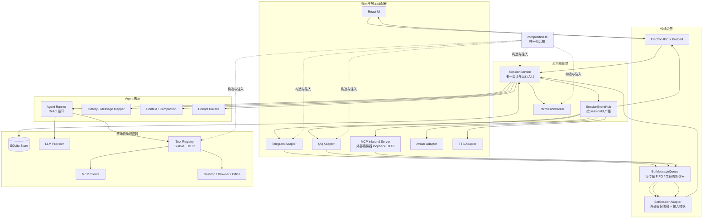
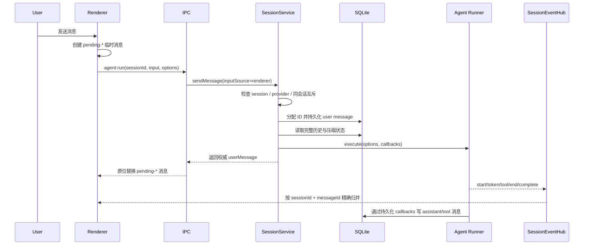
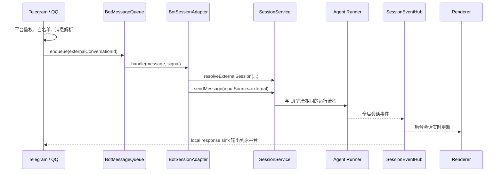
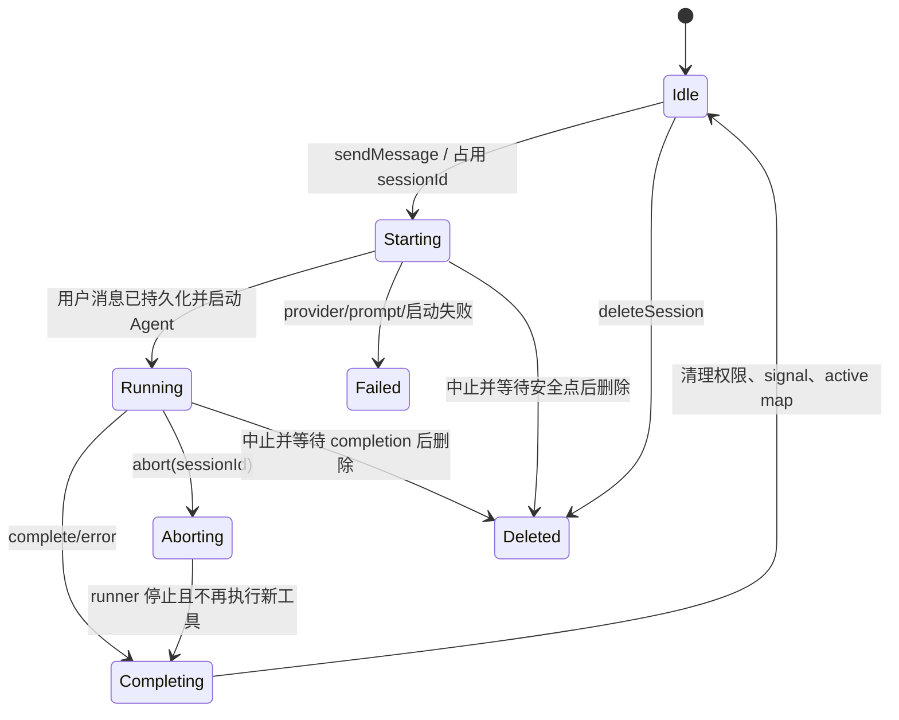

# Zhumora Architecture

本文档是 Zhumora 当前架构的权威说明，重点记录会话、消息、Agent、Bot、权限和事件之间的边界。

修改以下模块前必须先阅读本文档，并同时遵守 [`AGENTS.md`](./AGENTS.md)：

- `src/main/agent/`
- `src/main/ipc/`
- `src/main/bot/`、`src/main/telegram/`、`src/main/qq/`
- `src/main/store/`
- `src/preload/` 和 renderer 消息状态

如果实现与本文档不一致，不能悄悄引入第二套流程：应先确认正确方向，并在同一次变更中同步代码、本文档和测试。

## 1. 核心原则

Zhumora 只有一套会话消息与 Agent 运行用例：`SessionService`。它同时提供会话创建、查询、重命名、工作目录、删除和消息读取等核心会话 API；Avatar/TTS 等按会话保存的展示配置仍由各自适配器负责。

Electron UI、Telegram、QQ、对外 MCP 服务器（外部编排器）都只是输入/输出适配器。它们可以处理各自的连接、鉴权、消息格式和发送队列，但不得自行组装 Agent、维护会话运行状态、写入会话消息或实现权限策略。

必须始终成立：

1. 不同 `sessionId` 可以并行运行，互不影响。
2. 同一个 `sessionId` 同一时刻最多有一个 Agent run。
3. main/数据库是持久化消息 ID、历史、运行状态和权限结果的权威来源。
4. UI、Telegram、QQ 使用相同的历史构建、工具注册表、权限检查、压缩和中止语义。
5. 每个运行事件都带 `sessionId`；消息类事件还带 main 分配的权威 `messageId`。
6. 中止一个会话不会中止其他会话，并且中止后不能开始新的工具调用。
7. 压缩只改变发给 LLM 的 effective conversation，不删除或改写完整消息历史。

## 2. 总体架构图



依赖方向是“核心策略 → 应用编排 → 适配器 → 组合根负责装配”。图中的箭头表达运行时调用或事件流，不允许据此反向导入 UI、IPC 或具体数据库实现。

## 3. 所有权与职责

| 状态或行为 | 唯一 owner | 说明 |
|---|---|---|
| 活跃会话运行表 | `SessionService` | `Map<sessionId, run>`；实现同会话互斥和跨会话并行 |
| Agent 组装与启动 | `SessionService` | provider、历史、prompt、工具、权限、压缩回调均在此汇合 |
| ReAct 循环 | `runner.ts` | 只执行传入的单次运行，不读取 UI 或数据库 |
| 持久化历史与权威消息 ID | main + SQLite | renderer 只允许使用短生命周期的 `pending-*` 占位 |
| 全局会话事件 | `SessionEventHub` | renderer、Avatar、TTS 以及其他观察者统一订阅 |
| 工具权限请求生命周期 | `PermissionBroker` | UI/Bot presenter 仅负责展示和回传结果 |
| Bot 同一外部会话 FIFO | `BotMessageQueue` | 只保证传输顺序、传递 AbortSignal；不拥有 Agent 状态 |
| Bot 外部身份到 session 映射 | `SessionService` 存储边界 | Bot 适配器不得缓存第二份 session/run 映射 |
| 对外 MCP 服务器生命周期 | `McpServerManager` | 启动/停止/token/端口；不拥有会话与运行状态 |
| 外部编排器的任务状态 | `McpTaskSession`（taskProtocol 纯模块） | 等待/状态翻译；有界活动游标；完成/权限/终态；子 agent 复用 |
| 外部编排器的权限裁决 | `PermissionBroker` + 模式门禁 | 仅 delegate+normal+非 alwaysConfirm 可外部批准；危险级恒归人 |
| renderer 消息缓存 | Zustand | 是数据库历史的投影，不是事实来源 |
| 主窗口关闭→后台 / 真退出判定点 | `main/index.ts` 的 `quitting` 标志 + `backgroundPolicy.shouldCloseInsteadOfHide` | 关窗 hide；退出只走托盘/系统关机→`app.quit()`→`before-quit` |
| 主窗口外部导航判定 | `navigationPolicy.decideNavigation`（`will-navigate` + `setWindowOpenHandler` 唯一判定点） | 同源放行；http(s) 转系统浏览器；file:/javascript:/自定义协议一律拒绝 |
| 流程面板独立窗口 | `PanelWindowManager`（`src/main/panels/windowManager.ts`） | 只持有一次性开窗票据与辅助 BrowserWindow 生命周期；不拥有会话、Agent 或权限状态 |
| 后台可见性（托盘菜单 + 系统通知） | `BackgroundManager`（`src/main/background.ts`） | 只读投影，订阅 SessionEventHub/PermissionBroker，不拥有会话与运行状态 |
| 进程服务构造和实现注入 | `composition.ts` | `runAgent`、provider、context、store、tools 在这里注入 |

`SessionService` 是唯一允许调用注入后的 Agent executor 的模块。`composition.ts` 可以导入 `runAgent` 以完成依赖装配，其他 IPC、Bot、工具和展示模块不得直接调用它。

## 4. UI 消息流程



关键约束：

- UI 输入的 user message 不再通过 `agent:user_message` 回推给同一个 renderer，否则会和 invoke 返回值产生双写。
- `SessionEventHub` 仍把该输入交给 Avatar/TTS 等观察者；IPC event sink 只将 `inputSource=external` 的用户消息作为外部新增消息推给 renderer。
- `agent:run` 只等待运行成功启动并返回权威 user message；Agent 在后台运行，后续结果走事件流。

## 5. Bot 消息流程



Bot 层只允许拥有：

- 平台连接和重连状态；
- 平台消息解析、白名单和附件下载；
- 同一外部会话的输入 FIFO；
- 平台专用 response stream 和 permission presenter。

Bot 层禁止拥有：

- `activeSessions`、Agent abort controller 或批准模式的第二份映射；
- 自己的 Agent callbacks 持久化路径；
- 自己的 provider/history/prompt/tool 组装；
- 通过全局 setter 把 Bot 状态接回 IPC runtime。

`/stop` 中止队列当前正在处理的输入，其 AbortSignal 会连接到 `SessionService` 对应 run。最终的会话中止、权限清理和全局事件由会话服务完成。

### MCP 入站：外部编排器与 Zhumora 对话

`McpServerManager`（组合根构造）让外部编排器（Claude Code、Codex 等）把 Zhumora 当一个"可对话的协作者"。它是第四个输入适配器，与 Bot 走完全相同的链路：`McpInboundService`（编排）→ `BotMessageQueue`（同会话 FIFO）→ `BotSessionAdapter` → `SessionService`。

约束：

- 传输是 loopback-only 的 MCP streamable-http 服务（`127.0.0.1` + Bearer token），由 `src/main/mcpServer/transport.ts` 拥有；Streamable HTTP、JSON-RPC、协议版本协商和 `Mcp-Session-Id` 生命周期使用官方 `@modelcontextprotocol/sdk`，本地代码只负责鉴权、session 路由和 `zhumora_chat` / `zhumora_wait` / `zhumora_respond` / `zhumora_status` 工具适配。禁止重新手写一套 MCP 协议状态机。
- MCP 协议的 `Mcp-Session-Id` 是外部 conversation 的唯一键；不得使用 `clientInfo.name`、客户端名称或缺失 session 时的全局 `default` 代替。未知/过期 session 必须拒绝，DELETE 关闭时清理映射。该 conversation 到 Zhumora session 的映射走 `SessionService.resolveExternalSession('mcp', 'inbound', conversationKey, title)` 存储边界；同一 MCP session 永远落到同一 Zhumora session（上下文可累积），不同 MCP session 互相隔离。
- 对外可发现性同时放在三层：initialize `instructions`（声明 Zhumora 是可主动委托的 subagent）、`delegate-to-zhumora` MCP prompt（支持 prompts 的 host 可显式取用）、每个 tool 的强工作流描述（描述以“什么时候该委托”开头，并内联典型任务示例与负范围声明）。注意多数 host 不会把 initialize instructions 可靠注入模型上下文（opencode 无此通道，Codex 仅新版支持且从不消费 prompts），因此“委托意愿”文案必须写进 `zhumora_chat` 的工具描述——那是 Codex / opencode 模型唯一能看见的文字。措辞：`shared/mcpServer.ts` 的 `DELEGATION_IDENTITY` / `DELEGATION_PROTOCOL` 拼出 `SERVER_INSTRUCTIONS`（initialize），工具描述在 `protocol.ts` 内维护，两者由单测分别锁住同一组要素，不许各说各话。委托意愿措辞的三根支柱由单测锁死：同机能力声明（Zhumora 与编排器操作同一台机器的文件/应用/GUI/浏览器）、典型任务示例（给模型归类锚点）、负范围声明（沙箱内任务编排器自己做，消除边界不确定导致的默认保守）。三层都要求“一次投递、跟进至终态、不得把 running 当完成”。
- 任务状态由 `src/main/agent/taskProtocol.ts` 的 `McpTaskSession` 纯模块拥有：运行中 / 等待权限 / 完成 / 失败 / 中止。`zhumora_chat` 投递消息后至多等待 `wait_ms`，到期返回 `running` 转后台；调用方随后用返回的 `task_id + cursor` 调用 `zhumora_wait`。`zhumora_wait` 默认保持一个有界请求直到终态、权限请求或超时，它是兼容稳定 MCP 客户端的完成回调路径；`zhumora_status` 只保留作瞬时诊断/兼容查询，提示词禁止定时轮询。任务终态和有界活动环保留在会话上，断线重连后仍可取回。内部子 agent 工具复用同一模块，不复制等待/状态逻辑。
- 活跃的 `zhumora_chat` / `zhumora_wait` 请求通过官方 `notifications/progress` 发送 request-scoped SSE 进度；最终工具结果仍是同一 JSON-RPC 请求的权威完成响应。当前稳定协议没有可移植的“工具返回后再异步回调模型”语义，实验性 MCP Tasks 也不是所有客户端都协商，因此不得只依赖 Tasks 或私有通知。后台任务用 `zhumora_wait` 的长等待恢复同一语义。
- 外部活动流是 `SessionService` 本次运行 local sink 的只读、有界投影：assistant/reasoning 分块，tool call/result 和恢复事件结构化，使用 task 内单调 cursor；环形缓冲、单事件长度、单次返回事件数和字符数均有限制，reasoning 默认不随工具结果返回。它不得持久化第二份消息、不得替代 `SessionEventHub`、不得把无限 token 流一次性塞给外部编排器。
- 权限呈现者恒注册（`DelegatePermissionPresenter`），两种模式下编排器都能看到 `awaiting_permission`。能否裁决由 `McpInboundService.respond` 的门禁控制：仅 `permissionMode='delegate'` 且工具为 `normal` 级且非 `alwaysConfirm` 时可被外部批准；`dangerous` 与能力边界变更永远留给 Zhumora 桌面 UI 的人类。裁决唯一入口是 `PermissionBroker.respond`，与 UI 呈现者共用 first-response-wins；外部无法裁决的请求保持挂起，不得被伪造为已拒绝。
- 外部会话使用 `inputSource='external'` 与固定的 `sourcePrompt`（声明对方是编排器而非人）；运行事件经全局 `SessionEventHub` 广播，侧边栏像 Bot 会话一样实时可见。
- 服务器生命周期（启动/停止/token）归 `McpServerManager`；设置经 `normalizeMcpServerSettings` 归一化，语义等价不重启，token 变化触发重启使旧 token 立即失效。**token 稳定性（不变量：`enabled ⇒ token 非空`）**：token 由存储边界 `normalizeSettings → ensureMcpServerToken`（`shared/mcpServer.ts`）在首次启用时生成一次并随 settings 落库，此后**永不随应用重启自动轮换**——自动轮换会让外部客户端（Codex 等）已粘贴的配置集体 401。唯一轮换途径是用户显式重生成（保存后旧 token 立即失效）；用户清空 token 字段再保存等价于重生成。运行层 `McpServerManager` 只消费 settings 里的 token，`randomBytes` 回退仅覆盖绕过存储边界的内存配置（单测直构）。固定端口被占用时启动失败并向设置页报告，禁止静默切换端口使既有客户端配置失效；端口为 `0` 时才允许自动分配。

## 6. 会话并发与生命周期

### 按会话保存聊天模型

- 聊天模型偏好属于 session，由 `SessionService.updateModelSelection` 校验并通过 store 保存；migration v7 增加 `sessions.model_selection`，保存 `{providerId, model}`，null 表示使用全局默认。旧会话升级保持 null，不推测历史模型。
- renderer 的 `sessionModelSlice` 只维护会话列表中的偏好投影，没有全局聊天模型变量。下拉操作按明确 sessionId 保存，确认后更新目标会话；连续选择按该会话串行保存，待写 Promise 由 store 实例持有并在 settle 后释放，不同会话互不阻塞。发送与手动压缩等待目标会话的在途保存，保存失败反馈给用户。
- 运行和手动压缩共用 `sessionModelPolicy.resolveSessionModel`：显式请求覆盖 → 会话偏好 → 子会话创建模型 → 全局默认；显式换 provider 时不套用另一 provider 的保存模型。已删除/停用的 provider 明确失败，不能静默切到其他端点；模型选择不影响已启动运行的快照。子任务由父 scope 继续时显式传入创建配置，保持原 provider/model。
- 新会话使用默认模型；切换、删除后自动选中其他会话、renderer 重载和应用重启均由会话投影恢复对应选择。用户选择“默认模型”只清除目标会话的偏好；子会话保留创建配置作为缺省回退。

### 内部子 Agent（初版）

主 Agent 的协调角色通过 `sessionPromptOptions → AgentRunOptions.systemPromptRole → buildSystemPrompt(topExtra)` 放在身份之后、环境与工具清单之前；子会话注入聚焦执行角色，关闭委托时注入禁用说明。完整职责、单文件派工与等待/验收流程仍在追加指导中，来源适配器规则保持。非简单任务默认先识别、派发已就绪的独立小任务，无需用户提及 subagent；先确定接口再派发依赖它的实现。工具清单设独立 Agent Collaboration 分类。普通工具批量调用仍顺序执行，提示词不得把批量父编辑描述成真实并行；工具注册、权限与 `tool_choice=auto` 语义不变。

每个 provider 可设置 `allowSubagents`（缺失默认 true，settings JSON schema v15）。关闭时该 provider 仍可用于主会话，但从子模型菜单的可选项、子模型目录请求、`list_subagent_providers` 和提示词可用并发列表排除；已有保存选择保留为不可用，不能自动选到其他端点。子模型的显式指定、默认选择和继承都必须通过同一 `assertSubagentProvider` 校验。spawn 在创建会话前检查；SessionService 对所有子会话输入（含 continue 和独立打开后的手动输入）在开始准备前、准备结束且持久化输入前现读设置重查；手动压缩子会话同样校验。迟到的批准和准备不能绕过此设置。已启动的子运行不强制中止，允许完成、等待、取消；再次启动受新设置限制。限制属于模型路由资格，不替代 PermissionBroker，不过滤完整工具注册表，不新增并发数量上限。

Agent 可主动调用内置 `list_subagent_providers` / `spawn_subagent` / `list_subagents` / `send_subagent_message` / `wait_subagents` / `continue_subagent` / `cancel_subagent` 委托独立任务。工具由 `composition.ts` 构造并注入 Session API，不直接 import/call runner，不使用对外 MCP 传输，也不创建第二套 Agent runtime。

设置 → 通用 → Agent 行为提供 `subagentsEnabled` 开关（默认 true）和有序 `subagentModels: {providerId, model}[]`、`subagentDispatch: priority | spread`，保存后生效。settings JSON schema v16 在唯一 normalizeSettings 边界将旧 subagentModel 转为单项列表并移除旧字段；旧 null/缺失保持空列表继承主模型。新列表严格校验、精确模型对去重并保留顺序，停用或删除的选择不从保存值自动删除。db.ts 仍是 settings cache/保存/刷新 owner。关闭后不新建、不继续子运行，已启动任务可完成、等待和取消，完整工具注册表不变。SubagentScope、权限与准备结束/持久化输入前均现读权威开关，迟到批准或在途准备不能绕过。

子模型序列支持拖拽/按钮排序、添加模型、添加各供应商默认模型、移除；候选按允许子 Agent 的启用 provider 分组，通过已有 provider.listModels IPC 懒加载/刷新。目录只在视图实例缓存，草稿 provider 身份变化失效、卸载释放、忽略迟到结果；已选模型即使目录失败/未列出也保留，删除/停用/禁止 provider 则显示不可用。主 activeProviderId、provider defaultModel 和聊天模型偏好不变。新任务默认省略模型参数，由应用按已保存序列分配；空列表继承父实际模型。显式任务 provider/model 仅供用户指定，未给 model 时使用该 provider 首个序列模型、匹配父模型或其默认模型。continue 保留创建配置，不因排序、策略或可用性改变而静默换模型；原配置不可用明确失败。

`SessionService.childModels` 是子模型轮转游标的 owner，SubagentModelRouter 只持有有效序列/策略签名和上次 provider，不维护第二份 run 表；配置改变时重置。组合根注入 ProviderRequestConcurrency.snapshot 的只读计数副本，活动/准备中的子任务数量从 SessionService.active 的 subagentProviderId 现投影。选择负载为 max(实际请求 active+waiting, 子运行分配数)，工具/权限等待可能使选择保守；它仅用于派工，不是额外子任务数量门禁。priority 取首个有余量 provider；spread 跨主会话按有效序列轮转可用 provider，同 provider 多模型共用一个位置并优先使用首个模型。null 上限始终表示不限制；全部繁忙仍可创建选定子会话，其 HTTP 请求进入原可取消 FIFO，不另建待启动任务、定时 scheduler 或容量缓存。实际并发硬限制仍只有网络额度适配器。

- **运行 owner 不变**：`SessionService.active` 按 sessionId 独占运行、AbortController 和批准模式。父 run 持有一个 `SubagentScope`（`subagentScope.ts`），只保存子会话引用与 `taskProtocol.McpTaskSession` 状态投影，不拥有控制器、执行器或全局事件总线。工具必须用当前 run 的 `sessionId + AbortSignal` 取得该 scope；跨会话、上一轮的句柄和子 Agent 嵌套创建均拒绝。
- **独立历史**：每个子 Agent 是持久化 session，主进程分配消息 ID，经标准 `sendMessage(inputSource='external')` 写消息并广播。子上下文默认仅含委托任务、通用系统提示词和父输入适配器的 sourcePrompt，不复制父对话、不注入父工具调用片段。完整历史、权限、压缩和 MCP 工具均复用正常流程。
- **provider/model**：spawn 按上述序列/策略分配，显式请求优先。自动派工只在配置序列中跳过未知/停用/禁止 provider，无可用项明确失败；显式请求、继承及 continue 仍统一校验，不静默改换端点。API key/baseUrl 不进入模型可见清单。只有 provider/model 均与父运行相同时继承 reasoning effort。继续任务和手动压缩保留子会话创建模型。
- **持久化边界**：migration v6 为 sessions 增加 `subagent_parent_id / subagent_provider_id / subagent_model`，投影到 `Session.subagent`。父关系是审计来源，不使用级联删除：删除父会话会先停止并等待它的子运行，但子历史保留，可独立查看；删除单个子会话仍按原规则先 abort/settle。活动 task_id 不落库，应用重启不自动恢复任务，子历史和来源配置仍可查询。
- **真实并行**：spawn 等待子运行启动后立即返回 task_id（不等待最终回答）；父工具仍按顺序执行，多次 spawn 的子运行可以重叠。wait 复用 taskProtocol 的终态/权限等待，无定时轮询；返回完整状态与最多 12000 字符的回复，截断显式标记，原始完整回复仍在子历史。continue 仅允许最近一轮已 settle 的任务，复用 session 但返回新的 task_id，旧 task_id 不能停止或继续新一轮。通知只在当前 run 的安全检查点消费，没有后台自动启动或唤醒已结束父 run 的流程。
- **并发来源**：只由对应 provider 的 `maxConcurrency` 控制实际 LLM 请求，留空不限制；不再另设固定子 Agent 数量或累计子任务次数限制。父提示词和 `list_subagent_providers` 提供已配置并发值，不泄漏凭据，供主 Agent 规划批次；不同 provider 分别计数，名额与其他会话/辅助补全共享。待发 LLM 请求由 provider 队列等待，子会话仍是活动任务，不能当成失败或反复补建。wait 接受非空唯一的当前 run 任务 ID 列表，不暗中限制任务数量；每个返回文本仍受原有长度边界保护。委托输入文本最多 24000 字符，嵌套深度固定为 1。子 Agent 每轮仍拿完整工具注册表快照，委托工具不筛选/禁用其他工具。浏览器/物理桌面共享，DesktopControlCoordinator 原有独占策略不变，父会话持有桌面控制时由当前 owner 操作。
- **默认分工**：主 Agent 是架构师/项目经理，先明确接口、状态 owner、依赖与验收标准，把独立修改拆成单文件小任务，尽量先并发派发可执行任务，再正向等待并安排下一批；主 Agent 负责实际 diff 审查、跨文件一致性、最终测试/构建及用户汇报。子 Agent 聚焦指定文件或单个只读问题，不自行扩展成整项功能、多文件重构、依赖安装或全库自动修复；遇到额外文件需求/架构依赖时向父任务报告。
- **文件派工契约**：`spawn_subagent.targetFile` 可选以兼容旧调用，编码任务指导要求默认填写一个明确文件，范围只读/非文件任务可省略。`subagentWorkOrder.ts` 规范化相对/绝对路径并按 Windows 忽略大小写生成比较键，在持久化子输入里写明职责边界；任务结果带回 targetFile，continue 保留同一文件。`SubagentScope` 在创建子会话之前检查该父 run 的活动/正在启动任务，拒绝重复认领，不创建额外会话；文件归属持续到 SessionService 真正 settle，完成回调本身不能提前释放，失败/取消 cleanup 后可重新派发。此约束是协作契约和按父 run 的派工防冲突，不是文件系统沙箱；不解析符号链接身份、不建立跨会话全局锁，不改变工具可见性或 PermissionBroker 的裁决。
- **权限**：创建/继续/取消为 normal，provider 清单和等待为 safe。子工具始终经过同一个 PermissionBroker；父 run 活动时子运行读取父当前批准模式，子界面或工具不能提高它。父适配器的 permission presenters / timeout 和 sourcePrompt 继承，子任务另加只读权限状态 presenter；内部主 Agent 没有批准子工具的接口。外部 MCP delegate 的既有 normal/非 alwaysConfirm 门禁继续有效，dangerous 与能力边界仍归人。等待返回 awaiting_permission，未裁决请求保持挂起；批准后、执行前再次检查中止信号。
- **生命周期**：子 signal 连接父 run signal，用户中止父任务会立即中止所属子运行；正常结束、错误、删除和退出也会停止未结束子任务并等待有界 settle。单独取消子任务不影响兄弟/无关会话。父 completion 在子清理完成后才 settle，父 scope 随 run 清理释放。强制 cleanup 后迟到的 callback 不再持久化/广播，过期 run 也不能取消新 run 的权限请求。模型必须等待所需子结果才给最终回答；提前结束时遗留子任务被取消。
- **展示**：renderer 根据 Session.subagent 在侧栏纯投影中隐藏子会话；启动默认选择及删除后回退只选非子会话。完整会话缓存与数据库历史不筛除，流程图节点详情可打开子会话，查看子历史时侧栏高亮所属主会话。可打开独立历史、查看创建 provider/model、跳回主会话和停止子任务。主 run 活动时子会话只供查看/停止，不接受额外 UI 输入；main 同时校验父 signal，不能只靠按钮禁用保护。会话和事件继续用既有 shared Session/preload/IPC 契约，无新增通用 IPC 入口。

### 子任务异常诊断与原会话续跑

- `SubagentScope` 的每个 ChildTask 持有一个 `SubagentRunDiagnostics` 有界事件投影与原始工作目标；启动准备失败时将原目标补回继续指令，避免空子会话只收到一句“继续”。不新增运行表、控制器、scheduler、自动重启循环或数据库状态。scope 关闭后随原 task 引用释放。
- `subagentRecovery.ts` 是纯失败分类与恢复建议策略。优先根据 HTTP status、错误名称和网络 cause code 区分网络、超时、限流、供应商不可用、配置、上下文超限、无交付与未知故障；文本规则仅作有限兜底，分类是建议，不是保证可恢复。正常流中的重试、权限等待或暂时没有 token 均不等于死亡，不按静默时长自动取消/续跑。
- list/wait/start/continue 的原 JSON 结果增加 `diagnostics` 与 `recovery`：当前 run_number、continued_from_task_id、观测 phase/last_activity_at、完成工具数/错误数、最后工具、最近重试/不完整输出次数和失败类别/阶段；不复制正文/思考历史、错误凭据或 provider 配置。快照返回副本，既有结果文本与分页预算继续生效。
- `continuation_ready` 只表示本父 run 拥有的最新任务已终态且释放，不代表批准或 provider 可用。运行中/重试中、权限挂起、清理未结束及旧 task_id 都不能继续；实际 continue 仍重查全局开关、provider allowSubagents、同会话互斥、文件归属和 PermissionBroker。用户取消显示 respect_cancellation，不能被恢复建议当成自动重启信号。
- `continue_subagent` 复用同 session、完整历史、创建 provider/model、角色、文件及验收条件；新一轮返回新 task_id，run_number 递增，旧 ID 不得作用于新一轮。继续指令要求先查看历史和文件/产物现状，保留已成功改动，避免重复已成功的命令或外部副作用。对不同文件仍需新建任务，不在续跑时静默切换供应商。
- 缺少最终 complete 事件或最终正文为空的内部子任务投影为 failed/no_deliverable；非空报告即使说明尚未完成，仍按 completed 表示“本轮结束”，由主 Agent 按真实 diff/检查结果验收，必要时继续。此检查只包装内部子任务事件，不改 MCP 入站任务协议、SessionService 运行权威或全局消息持久化。
- 一次性终态通知带恢复建议，主 Agent 仍通过 wait_subagents 取回结果。瞬时失败建议在原因消除后继续原任务；配置/上下文问题先修复。连续两轮同类失败标记 repeated_failure_kind 并建议先排查，属于指导，不增加固定重试/子任务数量上限。没有自动执行续跑，父 run 结束、应用重启后也不会自动唤醒或恢复。

### 通用协作工作单、依赖与运行中消息

- `spawn_subagent.role` 可选 explorer / implementer / reviewer / verifier，分别聚焦一个只读问题、单文件实现、只读审查与指定验证。显式 implementer 必须提供 targetFile；其他角色的 targetFile 只是阅读/验证目标，不持有排他写归属。旧自由文本调用只在 `normalizeSubagentAssignment` 边界兼容，保留原行为；完整工具快照与 PermissionBroker 不变，角色是职责契约，不是文件系统/命令沙箱。
- 工作单支持 context、acceptanceCriteria、validationCommand、outputFormat、dependsOn，用户字段合计最多 24000 字符；任务和验收要求写入子输入，角色指导同时进入当前子 run 的系统提示词。继续任务保留角色/文件/创建模型及原始上下文，不能扩展成多文件功能。角色不另设 provider，不自动降级模型。
- dependsOn 仅接受当前父 run 的最新任务 ID，前置任务须 completed 且 settled=true；失败、取消、仍运行、权限等待、过期与跨 run 引用在创建子会话前拒绝。依赖回复作为有界数据证据附入工作单，不授予权限。这里是父 scope 的依赖校验，不是定时 scheduler，也没有待启动任务或自动依赖队列；主 Agent 等待前置结果并审查后显式派发下一项。
- `list_subagents` 给出父 run 最新任务的角色、文件、依赖和终态/settled 投影，按文本预算分页，无独立任务数量上限，不泄漏凭据或完整回复。Scope 持有 task 历史与 latest 索引并在 close 清空；控制器、执行与会话状态仍只有 SessionService 持有。
- `send_subagent_message` 为 normal 工具，父 scope 核验当前任务归属，由 SessionService 向该子 ActiveSessionRun 的 RunInbox 排队；每条最多 12000 字符、待交付总文本最多 48000 字符，超额明确拒绝、不静默丢弃。消息仅补充当前职责上下文，不改模型、权限或文件归属；不打断正在执行的 HTTP、工具或权限等待。已产出最终回复进入清理的 run 不再接受消息；settle 后应 continue。
- runner 在发送下一轮前，或非截断正常完成候选回复已经落库后，消费协调消息；禁止插入 assistant.tool_calls 与全部 tool 结果之间。当前 assistant 必须先落库，再写入协调 user 及其权威 ID；WorkingConversation 消息/ID 同步追加。取消、过期或 forced cleanup 后不交付，inbox 在 abort/cleanup 清空。
- SQLite migration v8 为 messages 加 coordination_parent_id / coordination_task_id。协调 user 标明父会话和瞬时 task 审计来源，旧行两列为 null；该标记经既有 UIMessage/事件通道保留。`splitConversationTurns` 不把它当新用户轮次，继续任务仍对应下一条真实工作单，DB 重载后也不串错委托分支。task ID 是来源记录，不用于跨 run 恢复。
- 已 settle 且尚未被 wait 返回的子终态在父检查点产生一次状态通知（工作上下文 user，ID=null，不写第二份历史或私有 tool 结果）；通知要求主 Agent 用真实 wait_subagents 取完整回复，所以流程图只在实际 wait 时汇合。尚有活动任务而模型试图直接结束时，每个父 run 只追加一次有界协作检查提醒；原 maxRounds、恢复预算与 hard stop 优先，不无限强制重试、不伪造工具调用、不保证模型服从。
- 输入区“并行协作”是当前会话工作区的持续工作流偏好，随 ComposerDraftProvider 跨停靠/独立窗口保留，发送只清空文字/附件/输入错误，不清除此开关；用户可手动关闭，切换会话卸载 owner 后恢复默认，不跨会话或重启持久化。每次发送通过 shared AgentRequestOptions.preferParallel → typed preload → IPC 校验 → SessionService 注入当前主 run 指导。它不改用户原文、模型、并发或批准模式，不能开启已关闭子 Agent，也不能让子会话嵌套派工。关闭仅恢复默认自动委托策略，不禁止 subagent。画布“展开子任务”是独立的显示/隐藏投影开关，不改变派工偏好，不调用 Agent 创建/停止 API；真正禁用子 Agent 仍在设置中。画布的显示偏好与派工偏好同样解耦：“展开历史/折叠历史”（foldHistory）与“展开子任务”（showChildren）是两个全局 renderer UI 偏好，另按会话记忆“已单独展开的折叠轮次”（expandedTurns，形如 {sessionId: turnId[]}）；三者存 localStorage（zhumora.flowFoldHistory / zhumora.flowShowChildren / zhumora.flowExpandedTurns），跨切换会话与重启保留，切会话重挂载时按存储值恢复而非回到默认，删除会话时清理其 expandedTurns 条目。“自动跟随”与镜头缩放/跟随是运行时相机状态，故意不持久化。这与“并行协作”形成对照：后者仍是当前会话工作区的瞬时偏好，切换会话卸载 owner 后恢复默认、不持久化。
- 通用提示词明确角色与派工触发条件，减少重复职责；记忆关闭时不注入记忆指南，允许架构必要的新文件。会话命名不再强占首动作，原运行结束后的 titleService 兜底保持。

启动和等待边界：SessionService 的提示词准备及 SubagentScope 的启动/等待 Promise 都通过 `runWait.ts` 响应当前 run 的 signal；底层准备永不返回时，取消也必须及时结束委托工具并生成对应 tool 结果。等待器在完成/中止/到期时清理 listener/timer，并继续观察底层迟到失败；迟到启动 handle 必须停止，不形成孤儿运行。`wait_subagents` 的状态等待和 settle 等待共用一个 deadline，`wait_ms=0` 只取快照。返回的 `settled` 表示该任务运行是否已释放；aborted 可以先于释放，继续任务必须等 settled=true。spawn/continue 的启动失败返回 `isError:true`，wait 成功查询到 failed 任务仍是正常工具查询结果。

终态发布边界：runner 的 onComplete 只完成回答持久化，`sessionRunCallbacks.ts` 把 complete/error 暂存到 SessionService 持有的 ActiveSessionRun.outcome。SessionService 等待子运行清理并从 active 表移除父 run 后，才向 SessionEventHub 和 local sink 发布 complete/error，然后 settle；清理期间用户中止不得再发布成功。aborted 仍立即报告取消意图，实际释放由 running=false/settled 表示。handle.completion 必须保留普通错误的原始 reject，不能因 cleanup 的 settled 竞速而被转换成成功。持久化轮次状态封装为 `persistedCallbacks.ts` 内的 PersistedAgentMessages 实例，callbacks 只做带过期 run 防护的适配，不建立反向契约依赖；手动压缩编排抽到 `sessionCompaction.ts`，仍由 SessionService 调用并注入存储/上下文依赖。

`subagentPolicy.ts` 保存参数校验与模型工作流指导，`subagentRouting.ts` 保存模型选择和轮转游标，`sessionContracts.ts` 保存会话应用接口；测试覆盖序列迁移/排序、跨 provider/主会话分配、准备期负载、满额排队、无限额度、设置变化、上下文隔离、权威消息和工具结果顺序、续跑、权限拒绝/等待、中止、卡死 settle、迟到写入与 fresh/v5 数据迁移。



- `active` 的 key 只能是 `sessionId`，不能使用当前可见页面或平台 conversation ID。
- `active.has(sessionId)` 时，第二次 `sendMessage` 必须返回 busy；不能把两次运行混进同一历史。
- 不同 session 没有全局锁，可以同时请求不同 provider、执行不同工具。
- `abort(sessionId)` 只取消目标 run 和目标会话的权限请求。
- `deleteSession(sessionId)` 必须先中止并等待活动 run settle，再删除数据库记录，避免删除后 callback 继续写入。settle 等待是有界的：abort 后 runner 未能在 2s 内 settle（未响应信号的路径）时，`SessionService` 强制清理该 run 并记录错误，删除和 `stopAll()` 因此不会被卡死的 runner 永久挂起。
- `agent:run` 返回的 handle `completion` 与上述 settle 同有界性，并保留既有错误契约：中止时 reject `AgentAbortedError`、普通错误原样 reject、正常完成 resolve；卡死的 runner 在兜底触发时同样让出，等待者不会永久挂起。
- 应用退出时先停止 Bot 输入并调用 `SessionService.stopAll()`。

### 窗口生命周期：关窗 ≠ 退出（后台运行）

主窗口关闭默认收进系统托盘（`backgroundClose` 设置，默认开启；macOS 红点关闭本就走该语义，dev 模式关窗即退出）：`mainWindow.on('close')` 拦截事件只 `hide()`，不销毁。main 进程继续持有 `SessionService.active`、Bot 连接与对外 MCP 服务器，会话在后台**实时**运行；`renderer` 重新打开（托盘/任务栏/`second-instance`）后靠 `session:list` + `agent:running` + 事件流归并恢复完整状态，不依赖任何 renderer 内存中的运行态。

- **真退出唯一入口**：托盘菜单"退出"或系统关机 → `app.quit()` → `before-quit`（原有清理链，`stopAll()` 有界 settle 后进程结束）。`before-quit` 置 `quitting` 标志，此后窗口 `close` 不再被拦截为 hide。`window-all-closed` 不再作为退出触发源（窗口销毁只发生在真退出或用户显式关闭后台模式时）。
- **单实例**：`app.requestSingleInstanceLock()` 在 main 入口最早处调用；第二个实例直接退出，`second-instance` 事件聚焦/恢复已有窗口。它防止"窗口隐藏期间用户再启一个"造成双 main 抢同一 SQLite/MCP 端口/Bot 连接。
- **隐藏期权限请求不自动批准、不加超时**：UI presenter 是"人在场"的呈现面，窗口不可见时请求按既有语义保持挂起（`PermissionBroker` 的 first-response-wins 与 cancelSession 不变）。`BackgroundManager` 订阅 `PermissionBroker` 挂起状态与 `SessionEventHub` 的 `complete`/`error`，在窗口不可见时弹系统通知（点击回窗口），裁决仍只能由人在桌面 UI 做出——与外部编排器"无法裁决则保持挂起、不得伪造拒绝"同一原则。`aborted` 不通知（用户/外部主动行为）。
- **隐藏期 TTS 音频丢弃**：TTS 输出是 renderer 投影（§3），窗口不可见时合成继续、音频事件无人消费；无持久化损失，不为此新增 main 侧 playback。
- **主窗口导航守卫**：`will-navigate` 与 `setWindowOpenHandler` 两个入口共用 `navigationPolicy.decideNavigation` 纯函数判定（同源放行 / http(s) 交 `shell.openExternal` / 其余拒绝）。消息里的 markdown 超链接若走 Chromium 默认行为会把整个应用窗口导航走，renderer 的 `MarkdownView` 已把链接统一改为 `openExternal`（`mailto:` 交系统邮件客户端），main 守卫是兜底；生产 `file://` 文档 origin 为 `"null"`（opaque），与目标 `file:` URL 的 origin 相等即同源。
- `BackgroundManager`（`src/main/background.ts`）只拥有托盘与通知两个展示投影：订阅 `SessionEventHub`、`PermissionBroker` 观察器，**不拥有**会话、运行或权限状态；策略判断（何时提醒、hide vs close）是 `src/main/backgroundPolicy.ts` 纯函数。新增"后台提醒"类功能只能扩展这两个投影，不得让展示层反向持有 Agent 状态。
- 主窗口的就绪、关闭和导航回调捕获各自的 BrowserWindow 实例；只有仍为当前主窗口的实例销毁时才清空 `mainWindow`，避免迟到事件读空引用或误作用于新窗口。activate 对本次取得/创建的窗口聚焦，安全 webPreferences、导航策略和 hide/quit 时序保持不变。
- 原生文件对话框由 `ipc/dialogs.ts` 统一选择 Electron 重载：存活且可见的主窗口作为父窗口；隐藏或已销毁时只传 options，不传 undefined 父窗口。过滤器、用户取消/选择结果与错误原样传递，不新增 IPC 或文件访问能力。
- 系统通知图标通过 Notification 构造选项设置，显示失败通过 Electron 的 `failed(event, error)` 只记日志；失败不能批准、拒绝或清理挂起权限请求。通知的点击回窗、按会话去重与取消订阅/关闭清理仍由 BackgroundManager 持有。
- 流程/详情/输入区独立窗口仅作为当前 renderer React 树的同源 portal 容器：`panels:prepare` 只接受主窗口 owner 与固定 panelId（conversation/details/composer），生成 30 秒、一次性的具名票据；`setWindowOpenHandler` 只额外放行匹配 owner/票据的 `about:blank`，任意 URL、重复票据及子窗口新开窗一律拒绝。辅助窗口保持 contextIsolation=true、nodeIntegration=false；about:blank 按 Electron 契约继承主窗口 webPreferences，sandbox 与既有主窗口一致，不接受 renderer 指定 preload 或特权参数。
- 辅助窗口不加载第二个 App、不增加 Agent/权限/TTS 事件订阅，React portal 共享既有 Zustand 投影与上下文，实时消息、选中详情、主题和字号一致。其导航一律拦截，http(s) 仍走系统浏览器。窗口控制仅接受原 owner + 有效窗口 key + 固定 minimize/maximize/close action；不能指向任意 BrowserWindow。关辅助窗口只恢复面板停靠，不中止会话、不 hide 主窗口、不调用 app.quit。owner 销毁或整页重载/renderer 卸载/真退出时清理辅助窗口与票据；关主窗口 hide 的原策略保持。
- 辅助窗口存活时，`PanelWindowManager` 暂时关闭 owner webContents 的后台节流，保证主窗隐藏后的既有 token 批量刷新仍服务可见辅助界面；最后一个辅助窗关闭时恢复先前节流值。画布镜头更新的 animation frame 使用当前 canvas 的 ownerDocument/defaultView，不依赖已隐藏主文档的帧回调。这些是展示窗口调度，不改变会话、权限或后台通知策略。

## 7. 事件与消息协议

所有 Agent 事件通过 `AgentEventSink` / `SessionEventHub` 传播。结构事件必须携带：

- `sessionId`：确定目标会话；
- `messageId`：确定 assistant/tool 消息；
- 明确的阶段或终止原因，不能依赖“当前消息”或数组末项猜测。

事件的主要消费者：

- IPC sink：映射到 preload/renderer 的强类型事件；
- Avatar sink：把运行状态投影为 idle/thinking/speaking；
- TTS sink：停止旧语音并消费最终 assistant 输出；
- Bot local sink：将当前 run 的输出发送到来源平台。

`SessionEventHub` 保存全局订阅者；每次运行通过 `forRun(localSink)` 把全局订阅者快照与来源平台的 local sink 合并。local sink 只活在本次运行中，不注册为新的进程级总线。

新增事件时必须同步检查 `main → preload → renderer`，并测试两个 session 事件交错时不会串线。

## 8. 权限流程

`PermissionBroker` 是唯一权限决策入口：

1. `SessionService` 根据 `sessionId`、当前 approve mode 和完整工具注册表创建 permission check。
2. Broker 向全局 UI presenter和本次运行的 Bot presenter 发出请求。
3. presenter 只能展示、校验响应者并调用 `respond`，不能自行执行工具。
4. 中止、删除、超时或运行结束必须清理该 session 的悬挂请求。
5. 工具在获得允许前不得执行；用户中止后即使迟到的允许结果也不能触发新工具。

## 9. 历史与压缩流程

- `messages` 表保存用户能看到的完整历史。
- `mapPersistedHistory` 同时生成 LLM messages 与平行 message IDs。
- `sanitizeHistoryWithIds` 只在 assistant 后紧邻的连续 tool 结果中闭合调用，消息与 ID 同步增删；不跨 user/system/assistant 边界借用结果。完整组可在后续轮次复用调用 ID，悬空/非法组原子排除，重复或孤儿结果只从 effective 历史移除。
- compaction 只保存 `{upToMessageId, summary}`。
- 自动和手动压缩都必须复用相同的历史清洗和安全边界规则。
- assistant `tool_calls` 与全部对应 tool results 是不可拆分的原子组。

发送前预算检查由 `AutoCompactor.applyIfOverThreshold` 统一编排：普通轮次传本轮完整工具快照，`finalizeRun` 在追加收尾指令后传空工具表，均计算 system、有效消息、工具 schema、调用/结果 ID 和图片估算，乘原有 1.2 余量。输入预算为窗口的 90%（为输出预留 10%）；压缩触发阈值仍为窗口的 81%。摘要请求独立按实际 800 输出 token 预留与输入总预算检查，不得只限制单条摘要输入。

- `history.planCompactByTokens` 按最近消息的 token 预算选择连续后缀，不因消息只有两到四条而跳过；至少保留最后一条，并将边界回退到完整工具组。最近一组独自超预算时保留其调用和全部结果关联，不能拆组或丢结果来获得合规序列。
- `compaction.ts` 只规划摘要与安全边界，`summaryInput.ts` 对整个摘要源采用有界首尾摘录，并保留单条限制；摘要输入仍必须经过 `assertContextFits` 才能发送。摘要失败/空摘要时仅允许当前工作上下文降级截断，不覆盖旧压缩记录。用户中止须传播，不能当成摘要失败继续。
- 自动压缩最多一次摘要规划，再由 `toolResultProjection.ts` 做至多九次纯文本预览收缩，随后重新计算完整请求。仅工具结果正文可投影；用户输入、system、工具表、工具调用参数、消息 ID、tool_call_id、消息次序和图片附件不变。JSON 结果按长字符串字段缩减，保留结构、类型和关联/路径等字段；无法安全缩减的结构必须由预算检查拒绝，不能粗切 JSON。
- 自动压缩的摘要成功且最终请求预算检查通过、未中止时，才持久化 `{upToMessageId, summary}`；边界取被折叠前缀内最后一个真实 ID，跳过虚拟消息。结果预览仅在 run 的 WorkingConversation 中，绝不写回原消息或持久化成另一份历史。手动压缩复用同一摘要规划和摘要请求预算，保存成功摘要后，下次运行仍须根据实际 system/工具快照执行完整请求检查。重载后从完整历史构建，发送前重新执行同一预算策略。
- `assertContextFits` 拒绝仍超输入预算的请求并报告估算、预算、窗口与输出预留，不发已知超预算 HTTP，也不无限重复压缩。收尾不得吞掉预算错误/用户中止并发布成功。这里是近似估算保护，不宣称等同服务端 tokenizer；尚未增加 context-limit 400 自动恢复或真实 usage 校准。现有 compact 通知仍为 effective 消息估算，完整请求检查数字记录在 Context check/recheck 日志中。

不要为 Bot、UI 或恢复逻辑各复制一份历史映射/压缩实现。

### LLM 响应完整性与运行终态

- `finish_reason` 只描述一次模型生成的结束，不是用户目标完成的证明。`turnDecision.ts` 统一裁决响应：有效完整工具轮继续执行；`stop` 且有正文、无工具时才是正常最终回复候选；空正文且无工具（包括 reasoning-only）最多追加两次合成继续指令，仍为空则抛 `AgentCompletionError`，禁止回落到 complete。length、流不完整、工具参数损坏的恢复耗尽同样明确失败，部分输出和不可执行工具组的占位结果保留。
- `RecoveryBudget` 由单次 runner 持有，空响应与不完整响应各有独立连续预算（各两次），工具轮可重置这两项连续计数；全 run 恢复总上限为四次，永不随工具轮重置。普通非空 stop 不再进行额外 LLM 语义复核，也没有复核/语义续跑预算。Provider 显式错误与网络尝试遵守可取消的用户 maxRetries；无 finish_reason EOF、length、空交付仍走各自有界恢复，不能借网络无限重试绕过生成恢复上限。
- `llm/streamResponse.ts` 只负责单次 HTTP 响应读取，SSE 聚合与格式验证仍在纯模块 `sseAccumulator.ts`/`sseEventBuffer.ts`；并发额度和透明重试归 provider 适配器。完整流须有有效的选定 choice finish_reason；仅 EOF 或仅 `[DONE]` 不算完整。兼容 finish_reason 后直接 EOF、不带末尾换行、usage-only 尾块，以及缺失 MIME / text/plain 代理（正常回复仍须是合法 SSE chat 数据）。读取边界按首个非空白字符识别误标 MIME 的 JSON 错误，缺失 MIME / text/plain / text/event-stream 下的 JSON error 同样保留完整原文和状态，进入原错误/429 重试链；不会伪装成 missing_finish。`[DONE]` 后取消 reader 并释放网络名额，不等待长连接关闭。显式非 SSE MIME、错误 JSON/SSE error 和损坏 chat 数据明确失败，不能当作正常生成结束。
- 流读取有独立时钟：120 秒无网络字节由 provider 中止；10 分钟无正文/思考/工具进展由 reader 判为不完整，心跳、空工具分片、重复的工具身份不重置进展时钟；只有新增 ID 或非空函数名/参数增量才算工具进展；finish 后最多排空尾流 5 秒。已有非空纯文本 stop 且无工具/refusal 时，尾部网络断开或排空超时只记 warning，不触发重复续写；工具响应不能使用这个宽容路径。用户取消始终优先，reader 等待可被 signal 打断。SSE 支持 LF/CRLF/CR 与跨块 UTF-8，非法 UTF-8 明确失败；单行/单事件上限 8 Mi 字符，单响应上限 64 MiB，超限明确失败而不裁剪成有效交付。
- 流内显式 `error` 与格式损坏分开处理：`ProviderStreamError`、兼容 HttpError 的 `ProviderHttpError` 保留完整 error、原始 envelope/正文、HTTP 状态与 Provider 状态、请求 ID 和可用 cause；不脱敏、不筛选原始字段、不截断，也不记录认证请求头。`providerFailure.ts` 在唯一错误边界分类：明确认证/额度/策略/无效请求终止，限流/瞬时服务错误/缺少确定性拒绝证据的未知 Provider 错误可恢复；HTTP 200 不覆盖内嵌错误，真实 HTTP 4xx 拒绝也不被响应体的限流字样改成繁忙。非法 SSE/JSON/内容结构属于 protocol，不混入 unknown 后无限重试。generation.providerError 保存结构化证据，失败阶段沿 purpose；原始详情仍沿 Error.message → 持久化 error 消息/SessionEventHub → 节点详情传播，不能把未知状态伪造为 429。
- LLM 繁忙提示仅对应 HTTP/流内明确 429（支持数字/三位字符串 status、status_code、code，或明确限流 code/type）；`llm/providerRetry.ts` 统一裁决 HTTP/SSE/非流式的重试，未知 Provider 显式错误也进入相同策略。maxRetries 原值生效：0 不重试，N 最多 N 次，-1 无限，不另加私有次数上限；429 判定优先于错误文本启发式。Retry-After 秒/日期或 retry-after-ms、可取消退避及每次尝试独立取得/释放 Provider 名额保持，退避不占额度。点名思考参数被拒绝仍只允许单次 streamChat 一次精确降级，显式关闭思考不能降级，没有进程级能力缓存。insufficient_system_resource/overloaded_error 归容量错误；无可恢复证据的协议损坏不重试，已确认的无效工具参数错误不靠网络循环掩盖。
- Provider 显式错误发生在部分正文/思考/工具分片之后时，`streamCallbacks.ts` 在重试前保存本次不完整输出，未执行工具组补齐占位结果且不进入 effective history；下一次输出使用新的权威 assistant ID，已执行工具不重放。有效部分正文追加到 WorkingConversation，合成继续指令 ID=null；重试前复用 AutoCompactor 完整预算检查，不新增运行或运行表。单次逻辑请求始终留在同一个 withRetry 内，换消息/续接不重置已用次数，也不消耗空响应/截断预算；未输出时直接重试相同请求。原始网络流中断与无终态仍由 runner 有界恢复。`beforeRetry` 是必须成功的结算/准备操作，异常原样传播，中止后不再发请求；UI onRetry 仍只负责提示。没有结算回调的独立 streamChat 调用不透明重放已输出片段。
- 既有 `agent:retry` 使用 shared `AgentRetryEvent` 的可选 reason=provider_busy/provider_error/network；main 只做事件适配，preload 保持强类型。renderer 按 sessionId 投影计数，明确 429 显示“LLM Provider 繁忙”，其它 Provider 错误显示“LLM Provider 响应异常”，网络异常保留原提示；assistant start/end 或 complete/error/abort 清除提示。普通与无工具收尾透传 onRetry，不新建恢复运行，不把暂时异常写成永久 error 消息。
- `finalizeRun` 仍只有一次无工具收尾请求，不新建运行或再次启动工具循环。只有完整流、finish_reason=stop、非空正文、无 tool_calls/refusal 的结果可作为进度总结；空/仅思考、length、流中断、意外工具、异常结束原因以及 HTTP/协议错误均传播到原错误链。意外工具不执行，并持久化真实调用与全部占位结果；有效总结使用 main 回调返回的权威消息 ID，generation=limit。达到 maxRounds/循环 hard stop 后即使总结有效，runner 仍以 limit 失败，不发布 onComplete、不重新开启工具循环。
- 异常继续只发生在当前 WorkingConversation；合成 user 指令的 ID=null，不进入 messages 表，不重放已执行工具，不删除/改写历史或压缩记录。真实 reasoning 可以独立落库，但不作为正文或交付。失败若发生在已落库的轮次之后，持久化回调追加独立 error 记录而不覆盖已有记录；重复 onError 幂等。
- 失败片段的结算与是否重试分开：重试耗尽或确定性拒绝时，最后一次已有正文/思考/拒绝说明及未执行工具占位仍保存；只有获准重试时才追加继续指令、压缩并准备下一请求。取消发生在工具占位结算中途时，仍补齐整组结果再中止；失败结算本身不得再次当成模型网络中断。
- 非流式辅助补全先读取原始正文，再解析 JSON；解析损坏属于 protocol，不能因 SyntaxError 引用了 network/socket 等正文而进入无限重试。原文、解析 cause 和请求 ID 保留。确定性工具参数错误只检查当前错误说明，不扫描附加 envelope 的历史 trace；明确 429 仍优先遵守用户重试配置。
- 限制收尾保存摘要后也须再次检查取消；同步持久化/事件回调触发取消时，按该摘要的权威 ID 更新 incomplete/aborted，并传播 AgentAbortedError，不保留 limit/done 的假终态。
- `AgentCompletionError` 经过既有 SessionService catch/cleanup/outcome 链发布 error，清理后才发布失败终态，handle.completion 保持 reject。UI/Bot/MCP 入站不拥有额外恢复或完成判断；MCP 得到 failed，内部子 Agent 诊断将此错误归为 no_deliverable，原有空交付投影仍作为防御检查。正常 complete 只表示本轮有有效交付且已结束，用户目标仍须按实际工具结果和验收条件判断。
- 普通完成按确定性事实裁决：完整正常 stop、有效正文、无待执行工具，再检查协调输入和取消；没有第二次 LLM 语义复核，也不根据括号、句号或“还要继续”等正文措辞强制续跑。`completeTurn` 先持久化当前 assistant，消费协调输入前后保持权威关联；同步回调触发取消时按该 assistant 的确切 ID 标记 incomplete/aborted，抛 AgentAbortedError，不能误标协调 user 或发布成功。模型正常停止不证明用户目标全部验收，实际工作仍按工具结果和用户要求的测试判断。
- `responseParsing.ts` 是消息请求投影边界。reasoning 独立持久化、永不混入 content；reasoningHistory=auto 仅对当前 DeepSeek thinking+tools 方言和 Qwen3.8，且来源 Provider ID/模型匹配时发送 reasoning_content。omit 总是不发送，preserve 是显式兼容选择并允许旧无绑定历史。Provider/model 切换只改变 effective 请求，历史保留。预算包含实际投影中的 reasoning；无工具收尾重新投影后再压缩。Qwen3.8 的 high 映射为 xhigh，off 使用 chat_template_kwargs.enable_thinking=false；其他模型仍按既有方言编码。没有新增 Provider 自动切换，也不改变用户网络无限重试设置。
- 辅助非流式 `complete` 保持字符串 API，但必须解析到单个 choice、stop、非空正文且无工具/旧 function_call/refusal；HTTP 200 error、length 和结构异常不能返回成功空串或残缺摘要，原调用方沿既有失败链处理。
- 输出预算在 responseParsing.ts 请求边界统一编码：Provider.outputTokenParameter 可显式选择 max_tokens 或 max_completion_tokens，透明代理可声明上游协议；auto 保留原默认：官方 api.openai.com 使用 max_completion_tokens（包含隐藏 reasoning），兼容端点使用 max_tokens。不推测自定义模型别名，不通过重发探测。普通流式、无工具收尾和辅助补全共用配置。
- SQLite migration v9 增加 messages.generation JSON；保存每轮的 Provider/请求模型/返回模型、响应/请求 ID、finishReason、matchedStop、传输终态、原因及计数。旧行缺少元数据保持未知，不伪造完整流。可选 captureResponses 默认关闭，开启时只保存最后 32 个 SSE data、最多 262144 字符的有界尾部，traceOmitted 标记省略；原始错误详情不依赖此开关。认证头不进入诊断；Provider 原始 error 不额外脱敏。
- 运行 owner 仍只有 SessionService；generation 只是消息投影。持久化后的取消状态通过 `onAssistantGeneration → updateMessageGeneration → agent:generation` 更新同一权威 ID，不重发 assistantEnd、不改正文/工具，也不重复触发平台回复/TTS。main 分配单调 assessmentRevision；renderer 按 ID 拒绝旧元数据、迟到 end 或 DB 快照倒退；正文仍由 DB 决定。旧 checking/unverified/purpose=review 保留读取和展示兼容，不批量改成成功；新运行不再产生语义复核状态。incomplete/refused/unverified/limit 不画成功，旧非活动 checking 显示未确认。
- settings schema v19 在唯一 normalizeSettings 边界显式剔除旧 Provider.completionReview，避免对象 spread 带回已删除选项；移除复核类型、UI 和校验，保留 captureResponses=false、reasoningHistory=auto、outputTokenParameter=auto。设置与 IPC 继续共用类型/校验，无需 SQLite 表迁移，也没有另一套 runtime、权限入口或运行恢复表。

复查补充约束：SSE 先按事件组装多行 data，再解析 JSON；单请求只接受一个 choice，显式 index 必须为 0，禁止混合其他 choice 或 completion ID。工具分片 index 必须为非负整数，同 index 的非空 ID 不可改变，显式非 function 类型与旧 function_call 明确拒绝。refusal 单独保存并优先裁决，content_filter 归 refused，不因空正文或坏参数触发续写。非法/缺失 usage 保留未知并告警，不假计零。reader 的 cancel 为尽力清理，不等待可能永不 settle 的 Promise，锁与名额及时释放。

- 工具调用 ID 在同一 assistant 组内必须唯一；重复 ID 的整组不执行，真实调用和逐条占位结果仍保留在持久化历史，发送前只在有效上下文中原子排除该组，消息与 ID 同步清洗。
- hard stop 关闭当前组全部未执行工具后，立即退出普通循环，只允许一次无工具收尾；maxRounds=0 也不能绕过它。普通最终回复和有效收尾都以权威 ID 追加到工作上下文及本次返回消息；收尾取消保留已收到的正文/思考后传播中止，不发布成功。
- 持久化回调的新轮 ID 在首个正文或思考 token 前创建，并重置本轮流式缓存；上一轮正文不能混入下一轮失败记录。start 仍先于 token，失败记录不覆盖先前真实消息。

## 10. 依赖与文件边界

### 内置工具文本输出边界

- 限制放在产生文本的工具适配器，由 `tools/outputLimits.ts` 提供纯预览策略。每次命令独立创建 `BoundedToolOutput`，有界保留开头和滚动结尾；stdout/stderr 独立 UTF-8 decoder，达到预览上限仍继续排空输出，不因此终止命令。命令正文最多 500 行、48,000 字符、单行 2,000 字符，退出码和超时状态另附。
- `grep`、`glob`、`ls` 及搜索错误诊断受 48,000 字符 / 2,000 行 / 单行 2,000 字符限制，仍保留各自匹配条数上限。文件 `read` 保留原有 2,000 行 / 50 KiB / 单行 2,000 字符与 offset/limit；目录 `read` 另受 48,000 字符限制，续读 offset 按实际返回条目推进，不能跳过截断内容。`edit` 仅限制返回的修改预览，不裁剪实际写入。
- 浏览器正文/HTML 默认预览 5,000 字符，`max_length` 可缩小但不能超过 48,000 字符硬上限，另受行数与单行长度限制。截断必须显式标记，并提示缩小查询、分页或选择更窄 selector。命令不会自动保存完整日志，需要完整输出时由 Agent 显式重定向到文件后分页读取。
- 这是工具返回前的文本边界，不是 token 计数或整个请求预算，也不删除/重写已持久化历史。不得将字符串截断器无差别用于子 Agent / MCP 的结构化协议或二进制附件。权限、消息 ID、tool_call_id、中止和 Agent 工具快照规则不变。

### LLM Provider 请求配置

- 可选 `ProviderConfig.maxConcurrency` 限制同一 provider ID 的实际 LLM 补全请求数（所有模型、主/子 Agent、UI/Bot/MCP 入站，以及标题、记忆和上下文压缩共用）。留空/缺失归一化为 null，表示不限；只接受正的安全整数，renderer 输入与 main 保存/探测边界均校验。settings JSON schema v14 在唯一 `normalizeSettings` 边界为旧 provider 补 null，不改变 SQLite 表结构、模型选择或历史。
- 网络额度由 `llm/requestRuntime.ts` 适配器创建的 `ProviderRequestConcurrency` 实例唯一持有，组合根通过 `ApplicationServices.llmRequests` 监督保存刷新和退出释放。内部按 provider ID 持有活跃计数与可取消 FIFO，闲置条目立即删除，退出 dispose 拒绝待发请求并清理监听；它不持有 session/run、Agent 执行器或 AbortController，不成为第二套运行系统，不锁住其他 provider。
- `streamChat` 与 `complete` 的每个实际 HTTP 尝试都取得名额，完整流读取/非流式响应解析结束、失败或中止后 finally 释放。网络退避不占名额，思考参数兼容降级重新排队；队列等待时不启动流空闲计时，已取消的等待项不发网络请求。调用前现读已保存上限，既有 run 的 provider 快照不能覆盖新限制；保存后立即更新队列，提高/清空上限唤醒等待项，降低上限让已发请求自然结束再放行。模型列表/上下文容量/思考能力的元数据探测不消耗推理额度。

- Provider 的 `apiKey` 保留默认 `Authorization: Bearer ...` 语义；可选 `headers` 保存字符串键值。`shared/providerHeaders.ts` 是唯一请求头归一化、校验与合并策略：名称按小写规范化，自定义头按名称忽略大小写覆盖默认头（含 Authorization / Content-Type），API Key 留空时不生成默认 Authorization。
- settings JSON schema v13 由 `normalizeSettings` 为旧 provider 补 `{headers: {}}`，不改变 SQLite 表结构。非法名称、重复名称（忽略大小写）、非字符串值或 HTTP 非法字符拒绝保存；provider 探测 IPC 同时校验 renderer 草稿配置，网络请求不能绕过头校验。preload/renderer 继续共用 `ProviderConfig`，不新增通用 IPC。
- `llm/provider.ts` 的流式/非流式补全、模型列表、上下文窗口及思考能力探测均使用同一个请求头函数。会话、Bot、子 Agent、标题和压缩沿现有 provider 注入链消费配置，不拥有第二份认证状态。
- 模型列表/上下文缓存 key 包含端点、有效请求头（上下文另含模型）；main 中以哈希保存身份，配置变化自然失效，header key 大小写和排列变化不失效。模型列表保留 5 分钟 TTL/force，上下文保留进程生命周期/forceRefresh；renderer 的模型列表缓存与迟到探测响应防护同样包含有效头，设置视图卸载释放。
- 请求头原始编辑文本由设置视图持有，切换标签保留；仅合法文本进入 settings 草稿，非法文本阻止保存，取消/离开设置释放。header 值与 API Key 都是凭据，不进入模型提示词/会话历史，不记录到日志或校验错误。

| 文件/目录 | 允许职责 |
|---|---|
| `src/main/agent/sessionService.ts` | 会话应用用例、运行所有权、依赖编排 |
| `src/main/agent/sessionEventHub.ts` | 进程内类型化事件广播 |
| `src/main/agent/runner.ts` | 单次 ReAct 状态机，不接触 DB/UI/Bot |
| `src/main/agent/persistedCallbacks.ts` | Agent callback 到持久化和领域事件的适配 |
| `src/main/bot/sessionAdapter.ts` | 外部消息转换后调用 Session API |
| `src/main/bot/messageQueue.ts` | 外部 conversation 的 FIFO 和 transport abort |
| `src/main/telegram/`、`src/main/qq/` | 平台协议适配，不实现会话规则 |
| `src/main/mcpServer/` | 对外 MCP 入站：`transport.ts` 管 loopback/Bearer/session，`protocol.ts` 管工具、提示词与进度映射，`service.ts` 管任务编排；不 import runner/store，不实现会话规则 |
| `src/main/bbs/` | Zhumora BBS（Agent 讨论区）客户端：`client.ts` 纯传输层（fetch/配置经构造参数注入，不 import Electron，纯 Node 可单测），`format.ts` 把 DRF JSON 格式化成 LLM 可读文本（纯函数），`tools.ts` 提供 `bbs_read`（safe）/ `bbs_post`（normal，删除类 dangerous）/ `bbs_activity`（normal）。配置（token/开关/地址）每次调用现读 settings，保存即生效，无重连/重启生命周期；配置关闭时工具**不隐藏**（保持每轮完整工具快照语义），返回 `isError` 提示；后端 `can_post` / `can_join_activities` 是权威（403 原样透传）。token 稳定性规则与对外 MCP 一致：注册返回一次后落库，永不自动轮换 |
| `src/main/skill/` | Skill 加载与注入：`manager.ts` 按 Agent Skills 规范（agentskills.io）加载目录型（含 SKILL.md + 可选根级文件与 scripts/references/assets；单 .md 导入兼容但只取该文件本身，不枚举其所在目录的兄弟文件）或单 .md 兼容导入，`skillTool.ts` 提供按需加载的 `skill` 工具（safe 级）。渐进加载：系统提示词只注入 name+description 清单，正文与捆绑文件清单由模型调用 `skill` 工具时才返回；skill 变更经 `reloadSkills → refreshSkillTool` 同步（启动与 settings 保存两处）。frontmatter 校验失败的路径不得入库（`inspectSkillPath`），未知 frontmatter 字段一律忽略 |
| `src/main/agent/taskProtocol.ts`、`taskActivity.ts` | 会话即服务的等待、状态翻译与有界活动游标（纯模块，无 Electron/DB 依赖） |
| `src/main/background.ts`、`src/main/backgroundPolicy.ts` | 后台运行（关窗收托盘）：Tray/Notification 展示投影 + 纯策略函数（何时提醒、hide vs close）；不 import store/runner，不实现会话规则 |
| `src/main/navigationPolicy.ts` | 主窗口导航判定纯函数（`decideNavigation`）：同源放行 / http(s) 外链 / 其余拒绝；`will-navigate` 与 `setWindowOpenHandler` 共用，不依赖 Electron |
| `src/main/ipc/` | 输入校验、调用 Session API、事件映射 |
| `src/main/store/` | SQLite repository 和迁移，不实现 Agent 决策 |
| `src/main/composition.ts` | 唯一组合根和具体实现注入 |
| `src/renderer/` | 会话投影、展示和交互，不成为持久化权威 |

### Renderer 聊天页更新边界

聊天主页是对话执行画布，高频输入与流程图分成两个独立更新边界：

- `ComposerDraftProvider` 按 sessionId 随工作区实例创建，位于停靠/portal 挂载点之外，持有未发送文字、待发送附件与图片错误。只有 `ChatComposer` 消费该 context：移动、停靠、弹窗/回收引起 composer 重挂载时草稿与附件保留，按键不触发流程图或工作区重渲染；切换会话卸载 owner，草稿/附件不跨会话。菜单仍是 composer 本地状态，草稿不写 main/数据库。
- `ConversationFlow` 按显式 `sessionId` 挂载独立 React Flow 画布。`useFlowGraph` 只订阅主会话与当前展开委托的消息、运行/权限/重试投影；未展开旧轮次的子历史不预加载，无关会话 token 不触发当前画布。输入草稿不进入图组件。
- `docking/DockWorkspace` 将对话流程区（含画布工具/状态栏）、节点详情和输入区置于同一可移动工作区，浮动边界包括底部输入面板，面板可相互覆盖，点击浮动面板提升其层级。输入默认底部停靠，可移动至五个停靠位置、浮动或独立窗口。输入高度由停靠分隔条/浮动或原生窗口尺寸负责，旧 inputAreaHeight 仅用于初始底部尺寸并在底部调整时保存，不再有第二个内部高度拖拽器。布局/浮动边界属于工作区 UI 状态，独立窗关闭回最近停靠位，卸载清理该工作区窗口，不写数据库/会话历史。浮动/独立详情仍按精确步骤 ID 更新。
- 独立输入区仍调用原 store action → typed preload → SessionService，不增设 Agent 入口或事件监听；发送前核对当前 session、实时运行状态及子会话父运行占用，迟到旧窗口不得把输入送往新会话。父任务活动时输入面板继续展示原只读说明/停止行为。布局与输入工具菜单使用 `AnchoredPopover` 按锚点 DOM 的 ownerDocument portal 展示，设置提示也进入该文档的 body，避开小面板裁切与跨文档焦点问题；模型、批准模式、附件、停止、IME/换行继续使用既有边界。
- `flow/history.ts` 在唯一解码边界识别内置 `spawn_subagent / continue_subagent / wait_subagents / list_subagents` 的结构化 JSON 文本结果（含 list 的 tasks 分页），核对 task/session 与 `Session.subagent.parentSessionId`；普通工具输出不能创建分支或更改任务状态。每次继续使用该子会话下一条 user input 对应的轮次，不把后续独立 UI 对话串进旧委托。带合法 failed/aborted 任务引用的启动错误仍展示对应分支；diagnostics 标明 startup 失败时不消耗 user input 序号，防止未持久化输入的启动失败把后续续跑历史错位。
- `flow/buildGraph.ts` 与 `projection.ts` 是纯投影，底层步骤保留每条用户输入、LLM 轮次及工具调用的权威关联：消息 ID 从 sessionId + messageId 派生，工具 ID 另带 assistant messageId + toolCallId，防止 provider 在后续轮次复用调用 ID 时覆盖旧记录。`indexToolResults` 仅在声明的 assistant/tool 原子组内按调用 ID 精确合入结果，孤儿结果单独保留。尚未返回的后续工具仍是待执行，非活动会话的残留调用仍是未完成，不能伪装成并行运行。
- 默认画布由 `compactNodes.ts` 按 LLM 的实际非空正文分成发言主节点，每次发言保留独立节点；后续无正文的 LLM 轮次与工具收进该发言。首句前的无正文步骤作为前缀归入首句，摘要、压缩边界、用户输入和孤儿结果不吞并。主节点以首个权威步骤 ID 为稳定锚点，保存有序 steps、LLM/工具次数和每次参数/结果引用；准备发言的流式占位提前分配，首个正文 token 不改变拓扑，终态若只有工具则归回前一发言。`detailLevel='steps'` 仅作为纯投影的细节模式用于回归检查。
- 节点状态由 `flow/status.ts` 分层投影，禁止“任一内部节点出错则整个容器出错”：工具 isError 只标红对应工具步骤；发言仅在自身 LLM 生成失败时 error，工具仍执行/排队/未返回时保留相应进行中或未完成状态，工具全部结束后不因局部错误把正常发言标红。折叠轮次和无终态快照的子任务按实际末尾 assistant 结果与完整工具组推断：最终非空正文可表示本轮已结束，空/仅思考/残留工具/未收尾状态为 unresolved；不把“任务目标已验收”混入节点完成状态。原始失败步骤、结果和 ID 全部保留。
- `flow/taskSnapshots.ts` 只用匹配 task_id、session_id、parentSessionId 的内置 wait/list 结果更新已声明委托；任务 completed/failed/aborted 分别展示为已完成/出错/未完成，不由工具错误数量推断。缺失子历史时也可使用已取回的终态；迟到 running 快照不得覆盖终态，续跑的新旧 task_id 独立。查询工具失败不能冒充被查询子任务失败；成功 wait 到 failed/aborted 子任务仍是成功查询，只有真实 wait 结果才能建立回流，list 状态不制造回流。SessionService/taskProtocol 的终态 owner 不变，toolResult(isError) 仍只是可恢复活动/诊断计数。
- `SpeechFlowNode` 在主卡片中显示正文与 `nestedSteps.ts` 派生的思考/工具小节点；思考只来自 provider 实际传回的 reasoning，不伪造、不用作发言正文。正文以一行到六行的有界自然高度展示，默认显示最新输出，向上阅读暂停滚动跟随，回到底部恢复；工具区没有预留空白，按实际行数撑开，最多 12rem，窄卡片切换为单列，超限在工具区内滚动。普通小节点预览最多六个，其余进入完整详情；连接分支/回流的工具保留在预览中并单独占一行。`SpeechSteps` 把具名端口放在滚动区域外，工具行不可见时端口锚定最近滚动边界，滚动/尺寸改变刷新 React Flow handle 位置，不改变具体调用关联。主/小节点 key 仅将权威关联的 JSON 元组编码成安全图 key，数据库和 IPC 的原始 ID 不变。
- 子任务从创建/继续工具小节点的具名 source handle 分叉，泳道同样按发言展开，delegate edge 的 `sourceStepId` 保留具体调用来源。子完成本身不产生回流；只有 `wait_subagents` 实际取回匹配 task/session 的终态结果才连到具体 wait 小节点的 target handle，return edge 的 `targetStepId` 保留具体 wait 调用。创建与等待可属于同一发言容器，此时回流回该容器内的后续 wait，而非 Agent 执行循环；下一主节点布局仍推进到已返回子结果之后。失败/取消结果可被父任务取回，但 running/awaiting_permission 快照不得伪装成完成汇合。
- 子 Agent 泳道是固定后景的装饰节点：外层 React Flow wrapper 不接收指针、不参与选择或焦点，点击/选择适配器也拒绝泳道。画布关闭选中时自动提升层级，避免背景盖住内部卡片；子节点仍作为独立卡片接受交互，背景空白处继续平移/缩放画布。
- 图是历史与事件的可丢弃投影，DB 和 renderer session cache 始终保存完整消息。历史默认按用户轮次折叠，最新轮次始终展开，单独展开的旧轮次保留展开状态；折叠卡片使用主题琥珀色、叠层图标与已折叠/点击展开提示，缩略图沿用同色。展开、选中、详情 tab、缩放、平移、跟随开关均属于组件短生命周期状态，不新增 Agent runtime 或持久化图状态。
- `FlowInspector` 用 `FlowStepList` 导航发言内的精确步骤，点击主卡片默认展示该句正文，点击思考/工具小节点直接定位对应步骤与 tab。`useFlowSelection` 与镜头共用 follow 开关，详情继续使用 `graph.latestNodeId`，多分支镜头构图不改变详情 owner：开启/恢复跟随立即把已打开的详情切到最新主节点，新主节点继续同步，清除旧步骤/tab 定位；自动跟随在同一主节点内通过 followDetail 纯策略选取正在执行的步骤，没有运行步骤时选最后实际步骤，queued/unresolved 不抢占；工具从参数切到实际结果，接续 LLM 自动显示其内容/思考，内部步骤导航保持选中行可见。暂停时记住最近自动步骤与 tab，手动点击主卡片仍明确回到该句正文；关闭详情不因跟随或新节点自动打开。选中历史卡片/小节点、在详情内选择步骤/tab 都暂停跟随，随后按步骤 ID 固定；暂停保留最近跟随的节点，不恢复过期选择。停靠、浮动与独立详情共用此组件状态，切换节点不能关闭或重建辅助原生窗口。正文/reasoning、参数、结果与用户图片继续使用原安全渲染边界。步骤行 memo 避免 token 让整段导航重渲染。权限保持原全局 FIFO 确认弹窗，画布仅显示按会话等待确认的只读投影，不猜测缺失的 toolCallId、不产生新裁决入口。
- `useDetailAutoScroll` 只管理当前详情步骤/tab 的阅读位置，与画布镜头跟随独立。运行中正文/思考增量、异步 Markdown/图表/图片尺寸及面板尺寸变化自动滚到底部；手动向上阅读暂停，回到底部恢复，完成时保留最后一次输出跟随。切换步骤/tab 重建阅读位置；观察器和合并帧使用面板 DOM 的 ownerDocument/window，卸载清理，支持停靠、浮动与原生独立窗口，不新增 Agent 事件订阅。
- 点击画布空白或子 Agent 泳道背景不关闭节点详情，也不清除当前详情的步骤/tab；详情的显式关闭仍走 `selection.close`，切换会话卸载工作区时清理。停靠、浮动和独立详情使用同一行为，不能把画布 pane 点击作为辅助窗口的隐式关闭入口。
- 发言卡片宽度由 `useFlowSizing` 按流程面板的实际宽度限制在 280–420px，正文、工具及字体决定自然高度，不再固定最小 264px。`speechSizing.ts` 为视口外节点提供有界估算；`useSpeechMeasure` 在卡片所属文档中读取未缩放的 DOM 尺寸，`useMeasuredFlowGraph` 按节点 ID/宽度/字体持有测量缓存，卸载工作区释放、移除节点清理，视口外内容/结构变化使旧测量失效。实际尺寸同步 React Flow measured、泳道、缩略图与镜头；React Flow 节点只固定宽度，发言高度保持 auto。正文增长到上限前的实际高度变化可推进跟随，到上限后 token 只滚动正文，不改变几何；手动导航时尺寸更新不能抢走镜头。`useFlowCamera` 是画布镜头的唯一调度点：用含估算/测量尺寸的投影 bounds 并 setViewport，“自动跟随”通过 cameraFollow 纯策略取得主流程锚点和各活跃会话的执行前沿；准备中的子 run 使用活动泳道状态定位现有卡片，背景泳道本身不进入镜头边界。初始化/恢复先建立构图，后续只有目标越出安全可视范围才最小平移，不逐节点居中。多前沿未手动缩放时按活跃范围适配，期间仅在必要时缩小，完成部分分支不反复放大；不会纳入整段旧历史。初始化与停靠重挂载不能另行 fit 全图覆盖跟随目标，延迟请求在当前 canvas 文档中合并并可取消。拖拽平移或显式适应全图会停用跟随并取消待执行的自动请求，可显式恢复；发言正文和工具区内滚轮滚动各自内容，不缩放画布。节点 memo + 视口裁剪限制重渲染；主题沿用既有浅色冷白、深色中性灰令牌。
- 画布滚轮/双指、缩略图及加减按钮缩放保留 follow，`useFlowCamera` 持有组件生命周期内的独立缩放偏好（8%–180%）。用户缩放期间暂缓镜头调度，结束后保持所选比例，必要时平移使当前工作可见；后续新节点、尺寸变化、详情开关、停靠/独立窗口重挂载及空视口恢复只更新位置，不覆盖此比例。未手动缩放时沿用自动适配单节点；显式适应全图清除自定义比例并暂停跟随。自动 setViewport 与用户缩放/平移分别识别，自动动画不得回写用户偏好或停用跟随，手动查看旧节点/步骤继续暂停跟随。
- `flowCameraScheduler.ts` 合并 ownerDocument 帧请求，自动跟随依据进行中的目标 viewport 计算，避免追逐动画中间值；用户导航清除该目标。自定义缩放或最低缩放仍放不下多个前沿时，cameraFollow 保留主流程与可放入视野的稳定邻近分支，不按 token 到达顺序轮番抢镜头；其余显示视野外活跃节点数。用户显式点击“显示活跃节点”才清除自定义比例并重建活跃构图，保持自动跟随开启；“最新输出”保留原显式单节点定位语义。详情不会因各子分支 token 自动切到不同子会话，手动浏览仍暂停跟随。
- `viewportRecovery.ts` 只检测投影改变是否使原本可见的实际卡片全部离开视口（装饰泳道不计）。新轮次触发旧轮次折叠或响应式重排导致空视口时，镜头按新投影一次性定位最新节点，保持 follow 偏好，不重建画布、不重拉历史、不修改会话或消息 ID。仍有卡片可见的正常追加及用户主动平移到空白处不触发恢复。恢复与自动跟随共用原 ownerDocument 帧调度和手动导航取消链，停靠/独立流程窗口使用相同策略。
- 初次加载子历史时，`applyHistorySnapshot` 按权威 ID 保留在读取期间收到、尚未包含在快照中的活动消息与流式内容；匹配的 DB 行是已落库终态，始终优先，非活动会话完全采用 DB 快照。迟到的 renderer invoke 用 `applyAuthoritativeUserMessage` 替换 pending：已在快照中出现的权威 user 只更新一次并移除占位，不能重复追加或移到回答之后。complete/error/abort 后的原重拉校准语义保持不变。
- 当前恢复的是消息中可验证的执行拓扑，未新增持久化 run/task 日志。历史工具耗时、完整重试/审批轨迹仍不能凭空还原；活动 task_id 的 owner 与生命周期仍是父 run 的 SubagentScope。
- `ChatView` 只组合 header、通知、canvas 和 composer；流式 token 内容变化不应导致整个聊天页外壳重渲染。旧 MessageViewport/MessageBubble/ToolCallChain 展示路径已移除。
- 无独立窗口标题栏行：`WindowControls` 在外壳之后渲染，叠放在现有顶部区域；按钮与图标显式 no-drag。聊天/设置标题与空态上缘仅用避开右侧 138px 控制区的独立背景矩形声明拖拽区，不能把整条 header 标成 drag 后仅靠 z-index 覆盖按钮；Electron 原生命中区域不会按视觉层级避让。权限/删除遮罩从 56px 控制条下缘开始，不能挡住按钮。最小化、最大化/还原、关闭仍使用原 typed preload API。renderer 不复制 hide/quit 策略，关闭语义仍由 main 生命周期边界决定。

完整历史仍由数据库和 renderer session cache 保存。展示层的组件拆分、memo 和虚拟化只能减少渲染工作，不得改变消息 ID、持久化内容、压缩边界或 `SessionService` 所有权。

### Markdown 与图表渲染边界

- 消息的持久化真值始终是原始 Markdown 文本；图表 SVG 只是 renderer 的可丢弃投影，不写数据库、不进入 Agent 历史，也不新增 main/preload/IPC 协议。
- `MarkdownView` 通过 `extractFencedCodeBlocks` 按围栏闭合状态把消息切成"Markdown 片段 + mermaid 块"：已闭合的 `mermaid` fence 立即交给 `MermaidBlock` 渲染（流式输出中块一闭合就出图，不等整条消息完成）；未闭合的块连同其后内容暂按普通 Markdown（源码）展示，闭合后下一帧切出。reasoning 和压缩摘要不启用图表，保持源码展示，避免半截语法反复解析。
- 图表导出走 `settings:saveDiagram` IPC：renderer 把已 sanitize 的 SVG 光栅化为 PNG/JPEG dataURL（DOM 尺寸检测 + 2x 画布）传入，main 经 `showSaveDialog` 落盘位图文件。它只是 renderer 投影到用户文件系统的单向动作，不新增持久化状态、不进数据库、不改变消息内容。**独立 SVG 落盘导出已移除**（生成文件历史上频繁出现 XML 解析/兼容问题）；导出格式只有 PNG/JPEG。
- `promptBuilder` 只声明这项 renderer 展示能力和安全输出规范，不把 Mermaid 注册为工具。来源适配器要求纯文本时，其 source prompt 优先，模型不得输出 Mermaid block。
- `MermaidRenderer` 是 renderer 组合根创建的进程级 owner。由于 Mermaid 配置是库级可变状态，初始化和渲染必须串行；缓存以 `theme + 完整 source` 为 key，容量有界，主题或源码变化自然失效。
- 图表使用 `securityLevel: strict`、关闭 HTML labels、限制源码长度和边数量，并对生成 SVG 再执行 DOMPurify SVG allowlist 清洗；URI 属性和非本地 CSS `url(...)` 资源也必须移除。禁止启用点击回调、任意 HTML、脚本、`foreignObject`、外链对象或其他交互绑定。
- 渲染失败、输入为空或超过限制时必须显示可复制源码；图表只是渐进增强，不能令整条消息不可读。

## 11. 禁止回归的旧设计

以下旧组件已经删除，不得以新名字恢复同类职责：

- `BotAgentBridge`：Bot 不再直接组装或运行 Agent；
- `BotRunCoordinator`：Bot 不再拥有 session run/activity/permission 状态；
- `AgentIpcRuntime`：IPC 不再拥有 active runs、abort controllers 或 approve modes。

同时禁止：

- 从 IPC、Telegram、QQ 或工具模块直接调用 `runAgent`；
- 在适配器中直接写 user/assistant/tool 会话消息；
- 通过模块级可变 Map、setter 或动态 `require` 拼接运行状态；
- 用“最后一条消息”“当前会话”推断事件目标；
- 为新平台复制一整套 Agent 执行链。

## 12. 扩展方式

### 新增聊天平台

1. 在平台模块实现连接、身份验证、输入解析、输出和权限 presenter。
2. 使用 `BotMessageQueue` 保证每个外部 conversation 的输入顺序。
3. 将标准化消息交给 `BotSessionAdapter`。
4. 不修改 runner，不创建新的 active session map，不直接访问消息 repository。
5. 增加平台适配测试和“同 conversation 串行、不同 conversation 并行、中止隔离”测试。

对外 MCP 服务器（§5 的 MCP 入站）属于同一类适配器：`McpInboundService` 只编排“conversation → 任务状态”，会话与运行规则仍全部落在 `SessionService` 与 `PermissionBroker`，不得为外部编排器复制第二套 Agent 执行链。

### 新增会话入口

任何新的 CLI、HTTP、语音或自动化入口都必须调用 `SessionService`，并明确：

- 外部身份如何稳定映射为 `sessionId`；
- 输入来源是 `renderer` 还是 `external`；
- 输出通过全局事件订阅还是本次运行的 local sink 消费；
- 中止信号如何连接到目标 session。

### 自动化或定时任务

当前仓库没有定时任务模块、scheduler runtime 或 scheduled-job 数据表。不得因为其他功能需要延迟执行，就顺手恢复已经删除的旧调度链路。

未来如果产品重新引入自动化，它必须满足：

1. scheduler 只负责触发时间、启停和投递，是 `SessionService` 的输入适配器；
2. 使用稳定身份映射到 session，并遵守同 session 互斥、跨 session 并行；
3. 输出走 `SessionEventHub`，权限走 `PermissionBroker`，不复制 Agent callbacks；
4. 不把整段任务实现代码塞进工具参数或消息 JSON；复杂任务保存结构化引用，由执行时读取；
5. schema 只能通过单调 migration 引入，并覆盖 fresh/legacy upgrade 测试；
6. 产品行为、失败通知、重试和取消语义必须先写入本文档，再实现代码。

### 修改会话运行

涉及 provider、历史、prompt、权限、工具或压缩时，先判断逻辑属于：

- `SessionService` 的应用编排；
- runner 的单次运行状态机；
- 纯策略模块；
- 基础设施适配器。

不能为了少改文件而把规则重新堆回 IPC 或 Bot service。

## 13. 必须执行的验证

所有会话架构改动至少运行：

```powershell
npm test
npm run build
```

并按改动覆盖：

- 不同 session 并行；
- 同 session 防重入；
- 中止/权限拒绝后不执行新工具；
- 删除活动 session 不产生删除后的 DB 写入；
- UI pending message 只被权威 ID 原位替换一次；
- external user message 能更新已加载的 renderer 会话；
- Bot 同 conversation FIFO、跨 conversation 并行；
- tool-call 序列和 message IDs 在清洗/压缩后保持合法且平行对齐。
