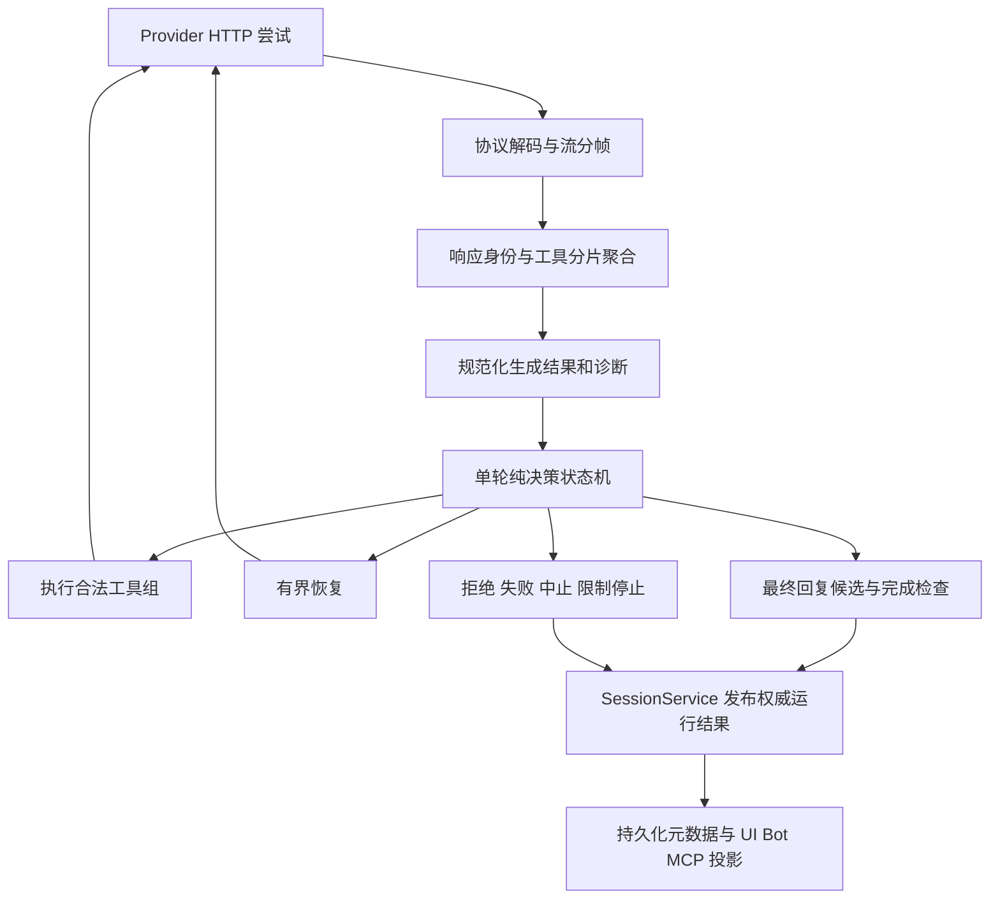

# LLM Provider 响应异常调研与完整治理方案

调研日期：2026-10-20；主流实现复核：2026-10-22（Asia/Shanghai）
项目基线：Zhumora 0.5.2，Git HEAD 88f09cd；空响应修复前对照点 45356e8。  
文档性质：前 15 节保留最初调研的缺口、证据与设计，第 16–18 节记录历史实现。**第 19 节按 OpenCode/Codex 公开源码修订方案，取代默认强制语义复核；第 20 节记录用户授权后的实际实现。** 当前实现以 ARCHITECTURE.md 为准；原生协议等未实现建议不能视为现状。本轮不提交代码。

## 1. 结论与范围

当前问题不能只用“再加一次空响应重试”解决。需要分别回答四个问题：

1. HTTP/SSE 传输是否完整；
2. 模型为什么停止生成；
3. 本轮是否交付了有效正文、拒绝说明或可执行工具调用；
4. Agent 是否完成用户目标，还是仅结束了一轮生成、触及限制或无法继续。

这四个结论必须分别建模。HTTP 200、finish_reason=stop、非空正文和 assistant 消息落库，任何一个都不能单独证明用户目标已经完成。

本次扩展检查覆盖 OpenAI Chat Completions、DeepSeek、SGLang、vLLM、llama.cpp 和兼容网关；另外对照 OpenAI Responses、Claude Messages、Gemini 原生 API，明确后续扩展边界。项目当前只有 Chat Completions 适配器，不能把原生协议直接接入现有 SSE JSON 解析器。

用户给出的时间线是回归定位依据：相同本地部署此前连续数月正常，空响应修复后开始出现半句停止。因此优先比较客户端版本，不把上游 Issue 当作本次故障归因。

### 证据等级

- **确认**：当前源码可以直接证明。
- **回放复现**：使用生产 Provider/Runner 或纯解析器，输入隔离构造响应得到结果；不是实际故障请求的抓包。
- **上游记录**：官方规范、源码或 Issue 说明这种异常存在；不证明用户部署命中了该问题。
- **待验证**：必须取得实际失败响应才能定位到具体请求。

## 2. 当前实现审查结果

| 编号 | 优先级 | 发现与证据 | 当前后果 |
|---|---|---|---|
| C01 | P0 | 非空正文、无工具、stop 直接 complete；turnDecision.ts:91，回放复现 | 半句话可以被保存为 done 并发布运行完成 |
| C02 | P0 | SSE 聚合器强制写入工具 type=function；sseAccumulator.ts:147，回放复现 | 不受支持的工具类型被转换后进入工具执行分支；后续权限检查仍存在 |
| C03 | P0 | 同一工具 index 的 id 可被后续片段覆盖，index 不校验非负整数；同上，回放复现 | 身份发生变化的调用仍可能被视为合法完整调用 |
| C04 | P1 | 忽略 delta.refusal；sseAccumulator.ts，回放复现 | 合法拒绝被当作空响应，注入继续指令，最终可能报“空响应” |
| C05 | P1 | 不识别旧 function_call 字段；回放中带前导正文和 stop | 工具请求被丢弃，前导说明被当成最终回答 |
| C06 | P1 | 非流式 complete 只读取 message.content；provider.ts:302，回放复现 | HTTP 200 内的 error 返回空串；length 截断摘要照常被接受 |
| C07 | P1 | stop 已到达后，尾部 socket 错误统一变成 streamInterrupted；provider.ts:169，回放复现 | 已完整的文本回答可能被要求续写，产生额外回复或动作 |
| C08 | P1 | 流内错误只有 429 可重试，HTTP 503 可重试、SSE error.code=503 不可重试；providerRetry.ts，回放复现 | 同一类容量故障因封装方式不同，得到不同处理 |
| C09 | P1 | tool_calls=[] 也设置 emitted=true；sseAccumulator.ts:147，回放复现 | 无实际输出也可能关闭透明重试 |
| C10 | P1 | 120 秒空闲计时按收到字节重置；provider.ts:211、streamResponse.ts:23 | 心跳不断但没有生成进展时，缺少独立的进展超时；终态后持续心跳也可能拖住结束 |
| C11 | P1 | 流式 HTTP 错误只保留正文前 500 字符；provider.ts:232，回放复现 | 关键原因在尾部时看不到；与流内 error 完整保留不一致 |
| C12 | P1 | 部分生成、恢复中的正文同样持久化 status=done；persistedCallbacks.ts:122 | 节点绿色“已完成”无法区分本轮结束与交付完整 |
| C13 | P1 | 当前模型历史统一不回传 reasoning；provider.ts:100、shared/types.ts:28 | 与部分 Provider 当前 thinking+tools 契约不兼容，需按端点/模型建模 |
| C14 | P2 | SSE 行缓冲只按 LF 切分；CR-only 回放失败 | 不完整支持标准 SSE 行结束符；CRLF 与 LF 已可用 |
| C15 | P2 | 不核对同一响应中 completion id 的一致性；回放复现 | 不同 completion 的片段可以被拼成一条成功回答 |
| C16 | P2 | usage 仅取三项基础数字，缺失值当 0，未严格验证类型 | 无法区分未知用量与零用量，无法解释 reasoning 消耗及部分统计异常 |
| C17 | P1 | finalizeRun 有效收尾后仍进入 finishRun/onComplete；runner.ts:200 | 到达轮数/循环限制后的进度总结，容易与目标已完成混淆 |

这些问题中，C01 等若干行为在空响应修复前已经存在，不能直接称为本次新增回归。应分别记录“已有缺口”和“本次新增差异”。

### 本次空响应修复新增的接收差异

旧版读取到连接 EOF；新版收到 [DONE] 后停止读取并取消 reader。新版还拒绝 finish_reason 后新增的正文或工具增量。

构造响应“正文 A → stop → [DONE] → 正文 B”时，旧版保留 B，新版忽略 B。这个差异已经回放复现，但该响应不符合正常终止顺序；尚无实际抓包证明用户失败轮就是这种形态。不能据此直接回滚到无限等 EOF，也不能把 [DONE] 后内容无条件合并进同一回答。

## 3. 需要覆盖的异常矩阵

| 层次 | 情况 | 正确分类与处理原则 |
|---|---|---|
| 请求/HTTP | DNS、连接重置、408、可恢复 5xx | 没有不可重放输出时按传输预算重试；取消立即终止 |
| 请求/HTTP | 429 限流 | 显示 Provider 繁忙；遵守 Retry-After 与取消；不重放已输出轮次 |
| 请求/HTTP | 401/403、欠费 402、模型不存在 | 明确失败并展示原始原因，不用继续提示反复请求 |
| 请求/HTTP | 400/422 参数或历史不合法 | 默认失败；仅已确认的参数能力拒绝允许一次精确降级；422 不作为繁忙重试 |
| 请求/HTTP | 上下文超限 | 区分真实 context 错误与普通 400；最多一次有界 effective context 调整，不删除完整历史 |
| 请求/HTTP | 200 + JSON error、HTML、登录页 | 读取真实响应体后报告错误/协议不匹配，不能统一变成空回答或只有 MIME 泛化信息 |
| SSE | TCP 块切在 UTF-8、CRLF、JSON 中间 | 先解码、再分帧、再解析；网络块不是事件边界 |
| SSE | 多 data 行、注释、空 data、BOM | 遵守 SSE 分帧；注释和空心跳不是完成 |
| SSE | 没有 finish_reason 的 EOF/[DONE] | 不完整，不接受为正常完成；进入有界恢复 |
| SSE | finish_reason 后正常 usage 尾块 | 合法，保留正文；同值结束原因重复可作为统计尾块接受 |
| SSE | 终态后连接关闭、重置、只剩心跳 | 单独建模尾部传输状态，不直接要求模型续写或永远等待 |
| SSE | 中途 error、finish_reason=error | 即使 HTTP 200 仍是错误；按错误种类和输出阶段处理 |
| SSE | JSON 损坏、工具字段类型错误、响应身份混入 | 协议异常；不能吞掉后成功，也不能自动执行可能混合的工具 |
| SSE | 新增未知字段/事件 | 已知协议中的无害扩展可跳过并诊断；未知输出或控制事件不能一律忽略 |
| 正文 | 空白、reasoning-only、零输出 | 没有拒绝等其他信号时才算空交付；有界继续 |
| 正文 | 非空半句 + stop | 最终回复候选；协议完整也不保证语义完成 |
| 正文 | refusal/content_filter/安全拦截 | 独立的拒绝/受限结果，不做空响应恢复 |
| 正文 | 实际输出在 audio、parts 等字段 | 支持的协议适配成结构化输出；未支持模态明确报不支持 |
| Reasoning | reasoning/reasoning_content 别名与类型差异 | 按模型/端点契约读取；不把对象或数组强行转成字符串 |
| Reasoning | 思考耗尽输出预算，最终答案没有预算 | length/不完整交付；区分思考与可见输出的用量和限制 |
| Reasoning | 工具标记落进 reasoning 或原始正文 | 视为工具解析异常候选；不从不可信文本中直接恢复执行工具 |
| 工具 | 参数 JSON 残缺，即使已有一部分完整调用 | 整组不执行；保留原始诊断与可关联的占位结果，要求重新生成 |
| 工具 | index 重用、id 变化、缺少身份、非 function 类型 | 聚合阶段阻断；禁止用最后一个字段覆盖后伪装成合法调用 |
| 工具 | 全量快照被当成 delta、重复片段 | 必须由已确认的端点契约决定拼接方式；禁止靠字符串相似度随意去重 |
| 工具 | 参数合法但工具未知、参数业务校验失败、权限拒绝 | 产生对应工具结果，让 Agent 继续处理；不直接把整个任务判错 |
| 生命周期 | 中止时仍返回正文/工具，迟到权限批准 | 保存真实部分输出，但取消优先，不能开始新工具 |
| 生命周期 | 模型轮结束但子任务仍活动、需要用户输入 | 应用编排状态优先；不能拿 stop 清理父任务的活动状态 |
| 生命周期 | 最大轮数/循环硬停后生成了总结 | 总结交付成功与任务完成分别记录；停止原因不能被总结掩盖 |
| 展示 | token 已显示但最终聚合内容不同、历史重拉覆盖 | main 权威 ID 精确校准；不能依赖“最后一条消息”修复 |
| 资源 | 心跳无进展、巨大单帧、无限无终态输出 | 需要可配置的进展/资源边界，超限明确失败，不能静默裁剪正文 |

## 4. 官方规范与 Provider 差异

### 4.1 OpenAI Chat Completions 与 Responses

Chat Completions 的 stop、length、tool_calls、content_filter、旧 function_call 是生成停止原因；拒绝还可能在独立 refusal 字段中。usage 尾块可以 choices=[]，未收到 usage 不能推导为生成失败。见 [Chat Completions streaming events](https://developers.openai.com/api/reference/resources/chat/subresources/completions/streaming-events)。

Responses 使用 response.completed、response.incomplete、response.failed 等事件，并保留 incomplete_details；不能只抽取 output_text 再当作 Chat Completions。见 [Responses streaming events](https://developers.openai.com/api/reference/resources/responses/streaming-events)。

**方案影响**：规范化阶段保留拒绝、原始结束原因和不完整原因；原生 Responses 若未来支持，使用独立解码器，复用后续决策层。

### 4.2 DeepSeek

当前官方 Thinking Mode 文档区分请求是否携带 tools：携带 tools 时，需要回传历史 reasoning_content；未携带 tools 时该字段不参与后续上下文。官方还说明，工具模式漏传可能导致 400。见 [Thinking Mode](https://api-docs.deepseek.com/guides/thinking_mode/)。

其结束原因除常见值外，还有 insufficient_system_resource、aborted。它们分别表示容量中断和生成中断，不是正常完成。见 [Chat Completions API](https://api-docs.deepseek.com/api/create-chat-completion/)。

**方案影响**：不能继续将“reasoning 永远仅供 UI”当成跨 Provider 规则；也不能把新文档套到所有历史版本或所有自托管 DeepSeek 权重。

### 4.3 SGLang

SGLang 的内部 token/string/regex 命中均可映射为 stop，并提供 matched_stop。当前上游流式实现先输出内容与工具，随后结束原因、统计、最后 [DONE]。见 [结束原因实现](https://github.com/sgl-project/sglang/blob/main/python/sglang/srt/managers/schedule_batch.py) 和 [Chat Completions 实现](https://github.com/sgl-project/sglang/blob/main/python/sglang/srt/entrypoints/openai/serving_chat.py)。

**方案影响**：保留 matched_stop 才能区分 EOS、停止字符串等证据；不能仅凭 stop 判断业务完成。

### 4.4 vLLM

当前官方文档明确 reasoning 曾叫 reasoning_content，并提醒只读取旧字段可能静默读空。工具和 reasoning 的支持依赖模型与 parser 组合。见 [Reasoning Outputs](https://docs.vllm.ai/en/stable/features/reasoning_outputs/)。

**方案影响**：当前“取第一个非空字符串”的别名兼容值得保留；若两字段都非空且不同，应记录冲突，不能盲目相加。参数与历史回传仍需要模型能力契约。

### 4.5 llama.cpp

当前 server 将 EOS/stop word 映射成 stop 或 tool_calls，输出限制映射成 length；reasoning_format 会影响是否分离 reasoning，模板决定工具解析能力。见 [server-task.cpp](https://github.com/ggml-org/llama.cpp/blob/master/tools/server/server-task.cpp) 与 [Server README](https://github.com/ggml-org/llama.cpp/blob/master/tools/server/README.md)。

**方案影响**：不能根据“OpenAI-compatible”推断 parser、reasoning 和工具序列的具体兼容行为；旧文档中的 tool 等别名也不能无条件推广到当前版本。

### 4.6 Qwen 模型侧契约

Qwen3.8-27B 官方示例保留 reasoning 历史，并使用 enable_thinking / preserve_thinking；声明的 reasoning_effort 档位为 xhigh、medium、low。见 [官方模型卡](https://huggingface.co/Qwen/Qwen3.8-27B)。

**方案影响**：项目只有 none/low/medium/high 的通用映射，不足以表达所有模型。应让“服务协议”和“模型/模板能力”分别建模。此差异是兼容性审查项，不能直接解释用户描述的客户端版本回归。

### 4.7 兼容网关

OpenRouter 文档说明，HTTP 200 提交后，错误可以成为第一条甚至唯一一条 SSE 数据；其统计尾块还可能重复相同 finish_reason，而非 choices=[]。见 [Streaming](https://openrouter.ai/docs/api/reference/streaming)。

**方案影响**：HTTP 状态不是最终成败；重复相同终态的空统计块应允许，不能新增过严的“一次 finish_reason 后一律报错”规则。

### 4.8 Claude 与 Gemini 原生协议

Claude Messages 包含 content block、message_delta、message_stop 和流内 error；stop_reason 包含 end_turn、tool_use、max_tokens、pause_turn、refusal 等。官方明确记录空 end_turn，并建议先检查工具结果历史结构，必要时新增继续消息。见 [Streaming](https://platform.claude.com/docs/en/build-with-claude/streaming) 和 [Stop reasons](https://platform.claude.com/docs/en/build-with-claude/handling-stop-reasons)。

Gemini 可能通过 promptFeedback 阻断而不返回候选；finishReason 还有 MAX_TOKENS、MALFORMED_FUNCTION_CALL、UNEXPECTED_TOOL_CALL 等。见 [GenerateContent API](https://ai.google.dev/api/generate-content)。

**方案影响**：这些情况不是“空 content”；未来支持时分别适配。通过 Chat Completions 网关使用时，还应保留网关提供的原始结束元数据。

### 4.9 SSE 标准边界

SSE 行结束符允许 LF、CRLF、单独 CR；多 data 行合并后再分发，注释是心跳。见 [WHATWG SSE](https://html.spec.whatwg.org/multipage/server-sent-events.html#parsing-an-event-stream)。

EOF 时接受没有空行分隔的最后一个合法 chat 事件，是本项目现有兼容扩展，应明确记录并测试；不能误称为 SSE 标准要求。

## 5. 上游 Issue 与可借鉴实践

| 来源 | 公开记录 | 对本项目的用途 |
|---|---|---|
| SGLang [#24839](https://github.com/sgl-project/sglang/issues/24839) | 思考区内 EOS 导致 reasoning-only 提前停止的报告 | 证明 stop 与答案交付不是同义；不是截图半句问题的直接证据 |
| SGLang [#29441](https://github.com/sgl-project/sglang/issues/29441) | 初始空 content 块与工具流客户端兼容问题的报告 | 空增量不能终结生成；项目当前不会因这一块直接结束 |
| SGLang [#18001](https://github.com/sgl-project/sglang/issues/18001) | 多工具流解析失败 | 补齐多工具、分片、末尾参数回放，不据 Issue 推断所有版本都失败 |
| llama.cpp [#18591](https://github.com/ggml-org/llama.cpp/issues/18591) | 工具流 index 行为变化的回归报告 | 聚合器不能把坏 index/id 静默归一化后执行 |
| OpenCode [#41469](https://github.com/anomalyco/opencode/issues/41469) | 空响应/unknown finish 导致会话静默结束的公开报告 | 不能声称其他 Agent 已普遍彻底解决；必须有本地终态策略和测试 |

这些 Issue 是故障类别和测试样本来源，不是本次实际故障的根因证明。Claude 官方的空 end_turn 建议也说明，恢复需要合法的历史结构与新输入，简单原样重试可能继续得到空回复；这不等于已经核实 Claude Code 的内部实现。

## 6. 推荐总体架构

保留现有依赖方向与 owner，在当前模块边界上补契约，不创建第二套 Agent runtime。

诊断通过显式注入的实例/sink 接入；若需进程级缓存或文件轮转，由组合根创建并负责清理。它不成为第二个全局 Agent 事件总线；UI/Bot/MCP 的运行投影仍经过 SessionEventHub。

### 6.1 四层结果契约

建议引入模块内的规范化响应，保留原始元数据，至少包含：

    transport:
      terminal: done | eof | error | timeout | aborted
      terminalChoiceSeen, doneSeen, errorStage
    generation:
      kind: stop | tools | length | refusal | capacity | interrupted | unknown
      rawFinishReason, matchedStop, nativeFinishReason
    output:
      content, reasoning, refusal, toolCalls, providerState
    identity:
      providerId, requestedModel, returnedModel, responseId, requestId
    diagnostics:
      warnings, rawError, timing, usage, byteCount, frameCount

这是拟议契约，不直接把每个供应商字段扩散到 shared/types.ts。跨 IPC/持久化边界时仅提升确实需要共享的稳定子集。

错误应能携带 partial result 与错误发生阶段。单个 streamInterrupted 布尔值不足以区分“正文中断”和“正文终态后统计尾部断开”。

### 6.2 能力与兼容归一化

- 服务协议：chat-completions；将来若需要再加入 responses/messages/gemini。
- 服务实现配置：SGLang/vLLM/llama.cpp/网关及已验证的版本差异。
- 模型/模板能力：reasoning 字段、档位、开关、是否必须回传 reasoning、工具格式。
- 自动探测失败保持 unknown，不擅自认定不支持，也不把未发送参数解释为关闭。
- 能力缓存以 Provider、base URL、模型和相关配置为 key；配置变更失效，owner 留在适配器。
- 返回的模型名可能是别名解析或路由结果，不要求等于请求名；响应 ID 一致性按明确协议检查。
- 只为已确认的差异添加兼容归一化，不从任意文本猜工具、猜 JSON 或猜结束原因。
- 不默认切换 Provider 或模型来掩盖失败；保持用户选定的路由，能力与上下文状态不得跨 Provider 混用。

## 7. 传输与解析方案

1. SSE decoder 支持全部标准行结束符、跨块 UTF-8、多 data 行、注释和空心跳。继续覆盖项目已支持的无末尾换行与 finish_reason+EOF。
2. 已知无害扩展字段保留或忽略；控制/错误事件必须识别。协议不匹配时指出实际协议，不把原生 Messages 事件当成空 Chat Completion。
3. 内容与 finish_reason 同帧合法。空 role/content 帧不算完成，不关闭重试；tool_calls=[] 不算实际工具输出。
4. 相同 finish_reason 的纯统计尾块允许重复。冲突终态、新增输出、身份变化明确记录为协议异常；不直接覆盖前态。
5. [DONE] 仍作为标准终止标记；不恢复到无上限等 EOF。若实际故障回放证明某个旧兼容端点存在额外顺序，需要独立、可取消、有边界的兼容策略，不能把另一个回答接进来。
6. EOF、[DONE] 缺少结束原因时保持现有不完整恢复。若完整文本终态已经到达，随后只是统计尾部连接故障，应单独分类，不自动注入“继续”。
7. 对有风险的工具轮，尾部协议/身份仍有歧义时不执行工具；不能照搬纯文本结果的宽容策略。
8. 分开统计排队时间、首个网络字节、首个生成增量、最后生成进展、终态等待。心跳只刷新网络活性，不刷新生成进展。
9. 终态后等待尾部设置独立且可配置的边界；等待缺失的可选 usage 不应造成无限运行。无输出的长 prefill 与开始输出后停滞使用不同策略。
10. 资源限制按帧、响应和诊断分别配置；触发限制报告明确原因并保留已有输出，不静默裁剪正文。初始阈值需基于现有大工具参数样本确定。

用量缺失应标记 unknown；数字类型、非负性和累计方式按协议验证。统计异常可记录 warning，不能为了补 usage 重放整次生成或工具。

### 输出预算与能力拒绝

当前上下文预算预留 10% 输出空间，但普通 Agent 调用没有下发 maxTokens；“预留”不等于实际给模型设置了输出上限。第一批修复保持原有采样/stop 行为，不突然硬塞一个较小 max_tokens。后续通过模型能力表达实际输出限制，区分 reasoning 与可见正文是否共用预算，无法确定的服务端默认标 unknown。

明确拒绝 stream_options/include_usage 等可选统计能力时，可以在无输出前做一次有记录的兼容降级；不能通过删除完整 tools 或用户明确要求的 reasoning 设置来换取表面成功。所有实际 HTTP 尝试都要计数，避免网络重试、参数降级与 Agent 恢复相乘后失去边界。

## 8. 重试与恢复决策

### 8.1 决策优先级

1. 用户 AbortSignal：中止，不执行任何新工具。
2. 显式拒绝、过滤、认证/计费错误：保留原因，结束为对应结果，不做空恢复。
3. 协议/身份/工具聚合异常：阻止工具，保留诊断；只对明确可修复的生成错误使用有界恢复。
4. 容量/传输异常：结合是否已有不可重放输出、错误阶段和预算决策。
5. length 或缺终态的不完整轮：保留部分正文；工具组完整性未确认时整组不执行。
6. 完整合法工具组：进入现有权限与执行阶段，stop 携带合法工具也可按契约接受。
7. 没有正文和工具，且没有其他交付/拒绝信号：空交付恢复。
8. 非空正文且无工具的正常生成：进入最终回复候选检查。

Provider 返回的 aborted/abort 不是用户 AbortSignal：远端中断需保留实际原因，不能伪装成用户主动停止；本地中止则始终压过迟到的远端结果。

### 8.2 推荐策略表

| 信号 | 行为 | 是否可以执行本轮工具 |
|---|---|---|
| 429，尚无实质输出 | 同一逻辑请求透明重试，展示繁忙和等待时间 | 否 |
| HTTP/SSE 明确的瞬时 5xx，尚无实质输出 | 使用统一错误分类和传输预算；422 不纳入 | 否 |
| 已有正文/思考/工具片段后发生错误 | 不原样透明重放；保留部分结果，按中断种类恢复或失败 | 否 |
| 完整正文终态后仅尾部网络异常 | 保存候选与 warning；不自动续写，按端点契约完成检查 | 不适用于工具执行 |
| 只有 EOF/[DONE]，无生成终态 | 不完整恢复 | 否 |
| length + 任何工具组 | 整组不执行并生成适当占位；引导拆小重新生成 | 否 |
| malformed arguments | 保留原始组与占位，排除出下次有效上下文，重新生成 | 否 |
| 工具身份有歧义 | 协议异常；不要“修好”ID 后执行 | 否 |
| tool_calls 结束原因却没有调用 | 特定的缺失工具交付，不用前导正文冒充完成 | 否 |
| refusal/content_filter | 展示拒绝/受限结果，不追加继续指令 | 否 |
| reasoning-only 或真正空响应 | 使用空响应预算新增合成继续消息 | 否 |
| stop + 正文 + 无工具 | 候选检查；需要时有界语义复核 | 否 |
| 未知结束原因 | 显示原值并明确异常，不默认映射 stop | 否 |

HTTP 与 SSE 内封装的同一错误使用一致分类；代码为字符串时只接受受控映射，不用“message 里包含 429”代替类型判定。尊重有效 Retry-After（秒或日期），等待必须可取消且不占 Provider 网络额度。

400/422 的参数降级必须同时满足“明确不支持该字段/取值、尚无输出、只改实际写入的字段、最多一次”。涉及用户明确要求的关闭思考等语义变化时，不能悄悄降级成服务端默认。

### 8.3 预算

| 预算 | 建议 |
|---|---|
| 网络/容量重试 | 保留现有 maxRetries 语义；0 禁用、用户显式 -1 仍为无限，但取消始终有效 |
| 连续空响应恢复 | 保留 2 次 |
| 连续不完整响应恢复 | 保留 2 次 |
| 全 run 生成恢复 | 保留总计 4 次，正常工具轮不能重置总计 |
| 非空异常完成恢复 | 最多 1 次，计入上述总计，不创建旁路预算 |
| 完成复核 | 最多 2 次控制请求，独立计费/记录；每次仅 1 个实际 HTTP 尝试，不做隐式重试或参数降级（该行已被第 17 节取代：复核的 429 按用户 maxRetries 重试，并允许一次参数降级；2 次逻辑复核/1 次语义继续的预算不变） |
| 上下文超限修复 | 最多 1 次；仍必须通过完整请求预算检查 |
| 强制收尾 | 一次逻辑无工具收尾，不开启新的工具或语义恢复循环 |

恢复预算耗尽永远不能落入成功分支。完成复核预算耗尽也不能变成“跳过检查直接通过”。网络无限重试是用户已有选择，不得借此让空响应、协议错误或完成复核也无限执行。

## 9. 非空异常完成的完整处理

### 9.1 能保证与不能保证的边界

只有“非空正文 + stop”时，没有通用的确定性算法能百分之百知道模型是否说完，或用户工作是否已完成。括号未闭合、没有句号、英文单词截断、未来时表达都只能提供线索，合法代码和正常简短回答也会命中。

因此，诊断日志、检查标点、强制要求 [DONE]，都不能单独修复这种业务问题。要自动处理无协议异常的半句，需要显式完成协议或有界语义复核，同时诚实保留“无法验证”的终态。

### 9.2 推荐完成门禁

对于工具型 Agent 任务，建议提供默认启用的有界完成检查；普通问答可使用轻量策略。分阶段上线，先回放评估误判与成本，再启用自动恢复。

确定性检查先执行：还有未关闭工具组、现有子任务协调提醒、用户中止、硬停/轮数限制、明确未交付信号时，不能直接完成。继续沿用 SessionService 的子任务 scope，不另建任务表来拥有活动状态。

无法靠确定信号确认时，调用一次不带执行工具的控制型复核，输入用户目标、当前候选、可验证的执行摘要和已知限制，返回：

    decision: final | continue | uncertain
    reason: 简短的具体依据

复核不是另一个 Agent，不注册子任务，不获得工具权限，不制造 assistant 对话记录；控制结果作为诊断保存。它必须经过同一 Provider 额度、取消链和实际费用统计。

- final：没有未闭合执行状态时，接收候选；标明依据是模型复核，不冒充外部事实已验证。
- continue：最多一次非空恢复；保存真实候选，工作上下文增加合成继续指令，调用现有 Runner 下一轮。
- uncertain、非法复核 JSON、超时或复核失败：明确“未能确认完成”，保留回答与工具结果；不静默成功，不擅自开始新工具。
- 恢复后的第二个候选最多再复核一次；再次要求继续或预算不足，结束为未完成。

这里最多两次复核、一次语义继续，不因正常工具轮重置。每个进入完成门禁的候选都必须得到决策，预算耗尽不能绕过。

### 9.3 运行结果与收尾

建议内部区分 completed、incomplete、refused、limit_reached、failed、aborted；最终 owner 仍是 SessionService。

最大轮数/循环硬停后的总结回答，即使格式完整，也只能说明总结交付完成；停止原因应保留为 limit_reached。收尾不可重开工具循环。收尾失败另附具体错误，不能覆盖已经发生的工具事实。

现有对外 MCP/Bot 若尚未升级终态枚举，未完成/限制停止可以先映射到现有 failed 加稳定 reason code，禁止映射 completed；需同时同步 shared/preload/renderer/适配器与契约测试。

复核可能误判，不能承诺任务语义百分之百正确。上线指标必须包含误续写率、合法短答误拒绝率、额外延迟与 token 成本。

## 10. 工具调用与历史不变量

1. 聚合器验证 tool index 为非负整数；身份声明后保持稳定。相同 ID 的重复声明可以接受，变化的 ID/类型不能覆盖。
2. name/arguments 以已确认的 delta 契约拼接，不把累计快照猜成增量。非 function 类型、旧 function_call 明确标识为不支持或由单一显式兼容适配器转换；不能静默丢弃或强制变成 function。
3. 收到完整终态、整组结构校验通过后，才进入现有工具执行阶段。参数 JSON 完整不代表整个生成组完整，length 轮不能先执行一部分。
4. 合法调用 ID 下的不可执行组，保留原始调用与全部占位 tool 结果；损坏组不进入下一次 effective conversation。
5. 身份本身不合法、无法关联的原始片段保存为诊断，不制造 provider call ID，不构造看似可执行的 ToolCall。已声明进入消息序列的调用仍须逐一关闭。
6. 已执行工具结果、消息正文与权威 ID 不因恢复而改写。合成继续消息沿用现有工作上下文规则，messages 与 IDs 同步维护。
7. 不按工具名+参数全局去重：相同参数可能是合法的新调用。也不自动重试工具超时；工具的外部副作用是否已发生，需要幂等能力或核验，不能由 LLM 请求重试来保证。
8. 不新增“流中看到完整参数就先执行”的投机执行。重复 SSE/响应回放不应再触发已完成的本地调用。
9. 用户中止在请求后、权限前后和每个工具开始前再次检查。权限裁决唯一入口保持 PermissionBroker。
10. 每个普通 Agent 轮的工具快照仍完整；不能用禁用部分工具来绕过某个 parser 的问题。

### Reasoning 与 Provider 状态

将 reasoning 的展示与协议回传分开。保留数据库已有原始 reasoning；只对明确要求的端点/模型构建结构化 Provider 状态，不能把思考拼进正文。

目前统一“不回传 reasoning”的架构约束若修改，必须同批更新 ARCHITECTURE.md、ChatMessage/历史映射、摘要和预算估算。回传部分也占上下文，不能绕过预算检查。

带签名或其他不透明状态的协议需要原样保留其结构；压缩边界不能留下孤立签名/工具块。不能为追求恢复成功而伪造、截短或把另一 Provider 的状态带过去。现有历史没有保存的数据不能凭空补造。

## 11. 诊断、持久化与 UI

### 11.1 每次尝试应回答的问题

- 这是哪个 session/run、哪一轮、哪次 HTTP 尝试、什么调用用途；
- 请求模型与返回模型、Provider、response/request ID；
- 请求中的实际输出限制、reasoning 配置、工具数与上下文估算；
- 收到多少字节、事件、正文/思考/工具增量；首次字节、首次进展和结束耗时；
- 是否收到 choice 终态、[DONE]、EOF，在哪里异常退出；
- 原始 finish_reason、matched_stop、native finish、error 及用量；
- 最终选择了重试、恢复、执行工具、复核还是终止，消耗了多少预算。

完整错误详情按用户要求原样保留，不新增脱敏或字段筛选；修正 HTTP 只留前 500 字符的问题。常驻记录元数据，原始 SSE 支持明确开启的本地回放记录/导出。容量和保留周期单独配置，不通过截断用户错误详情来控制日志大小。

### 11.2 持久化建议

最小落地可以增加版本化的消息生成元数据，记录 finish/交付状态、恢复原因和关联 runId；仅 status=done 无法表达这些信息。

为重启后仍能准确区分运行结果，建议再增加狭窄的运行审计记录，关联权威 userMessageId/runId 并保存 SessionService 发布的终态和原因；它只保存事实，不拥有 active run、AbortController、权限或调度。HTTP 尝试详情可存独立诊断文件，避免复制一套完整消息历史。

所有 schema 变更通过单调 migration，覆盖 fresh/legacy；旧记录标记 unknown，不能从历史 done 反推“已验证完整”。

### 11.3 展示语义

- “本轮生成结束”与“任务已完成”使用不同字段。
- 空/不完整恢复中显示原因与次数，部分正文标“输出不完整，正在恢复”。
- Provider 繁忙、模型明确拒绝、超限停止、协议错误、无法确认完成分别显示。
- 节点详情提供原始原因、请求身份、生成终态与运行终态。
- 工具失败仍是该工具的结果；只有 Runner/SessionService 的权威终态改变整个任务状态。
- IPC 事件增加元数据时同步 main/shared/preload/renderer；多会话按 sessionId、messageId、runId 精确归并。

## 12. 实施批次与验收

### 批次 A：建立诊断与原始响应回放

涉及 llm/providerErrorDetails、streamResponse、eventCallbacks 和独立诊断 owner；不改变正常完成判定。

验收：能解释一次成功、空响应、半句 stop、429、尾部 reset 的退出原因；同一原始响应可在修复前后解析器回放；完整错误与 ID 不丢失。

### 批次 B：确定性协议修复

涉及 sseAccumulator、sseEventBuffer、streamResponse、providerRetry、provider.complete。

修复工具身份/类型、空工具数组、refusal、CR-only、HTTP/流内错误一致性、完整 HTTP 错误、非流式结果验证和终态尾部分类。保留当前合法兼容形态，避免扩大重试到 422。

验收：下面的协议测试矩阵通过；无额外工具执行，无正常请求正文变化。

### 批次 C：生成/运行状态分离

涉及 persistedCallbacks、SessionService callbacks、shared/preload、renderer reducer/flow、store migration、Bot/MCP。

验收：恢复片段、合法最终回答、拒绝、硬停总结重启后仍可区分；单个失败工具不污染父任务；所有适配器收到一致终态。

### 批次 D：Provider/模型能力与历史契约

涉及 llm/reasoning、请求序列化、历史映射、上下文预算和压缩边界。

验收：当前 DeepSeek thinking+tools 等要求可表达；不要求回传的模型保持原行为；完整工具快照与消息/ID 平行不变量不变。

### 批次 E：完成门禁

先用固定候选样本和诊断回放评估，再上线工具型任务的有界复核/一次语义恢复。

验收：截图类型的半句候选可进入继续或未完成结果；正常短答/代码不靠标点被强制续写；复核失败和预算耗尽不会成功；硬停永不重新执行工具。

### 批次 F：按需求增加原生协议

Responses/Claude/Gemini 只在明确需要时各自实现解码与 Provider 状态，复用规范化结果、预算、权限和运行终态。不能为了本次修复同时重写全部供应商适配器。

每批先补纯函数/状态机测试，再接副作用与 UI；同批同步 ARCHITECTURE.md。修改前记录基线，结束运行类型检查、npm test、npm run build。当前 package.json 的 pretest/posttest 已覆盖响应、并发、上下文、窗口与 flow 专项；本次把新增响应回归也接入 test:responses，随 npm test 执行。

## 13. 回归测试清单

| 类别 | 必须覆盖 |
|---|---|
| 分帧 | LF/CRLF/CR、CRLF 跨块、UTF-8/emoji 各字节切分、BOM、多 data、心跳、无末尾换行 |
| 终态 | 正文与 finish 同帧、usage-only、重复同值 finish、冲突 finish、EOF/DONE 缺 finish、终态后 reset/心跳 |
| 错误 | HTTP 429/422/503、SSE 同类错误、200 JSON error、HTML、原始错误超过 500 字符、未知错误代码 |
| 重试 | Retry-After 秒/日期/无效值、0/-1、退避取消、排队取消、空工具数组不封死重试、已有输出不透明重放 |
| 输出 | 空、纯空白、reasoning-only、refusal-only、正文+refusal、未知模态、非空半句 stop |
| 工具 | 并行交错、index 缺失/负数/重用、id 变化、类型变化、重复声明、残缺 JSON、长度截断、旧 function_call |
| 历史 | 每个已声明工具有结果或占位、坏组不回传、成功工具不重放、消息/ID 平行、压缩不改 DB |
| 模型状态 | reasoning 别名、双字段冲突、必须回传与无需回传、重载历史、Provider 切换、不透明状态完整性 |
| 非流式 | 200 error、空 choices、缺 message、length、refusal、content 类型错误；摘要失败不覆盖旧摘要 |
| 完成检查 | final/continue/uncertain、无效 JSON、超时、候选恢复一次、第二次仍要求继续、预算耗尽、不执行复核工具 |
| 生命周期 | 多会话交错、子任务仍活动、用户中止与迟到批准、删会话后不写库、hard stop 不启动新工具 |
| 持久化/UI | fresh/legacy migration、旧状态 unknown、恢复提示、run 与生成终态区分、Bot/MCP 一致结果 |

随机分块回放之外，加入状态机性质检查：任何异常路径都不能执行未确认工具；任何恢复路径预算单调消耗；任何历史变更保持消息/ID 对齐。

## 14. 风险与明确取舍

- 过严的流检查会拒绝历史兼容端点，过宽则可能拼接错误响应；以真实回放和显式兼容配置取舍，不盲目吞错。
- 语义复核增加延迟和成本，也可能误判；必须有独立上限、取消和 uncertain 结果，不能被包装成绝对完成证明。
- Reasoning 回传可能明显增加上下文；必须同步预算、压缩与模型切换策略。
- 持续心跳与长 prefill 需要区分；进展超时默认值要经过实际负载评估，不能把 120 秒直接复制到所有阶段。
- 客户端取消不保证每个上游立即停止计算/计费，但本地必须停止新的工具与后续请求。
- 增加审计元数据不是恢复第二套 runtime；所有活跃运行仍归 SessionService，所有权限仍归 PermissionBroker。
- 诊断先行不能代替业务修复。非空半句若携带完全正常的 stop/DONE，只有解析器校验仍然无法解决，必须落实完成门禁或显式未完成结果。

## 15. 本轮验证记录

- 使用生产 Provider 与纯决策状态机完成隔离响应回放，未请求实际 LLM 服务。
- 复现 refusal 丢失、旧 function_call 丢失、工具类型强制转换、工具 ID 覆盖、负 index 被接受、不同 completion ID 混合、CR-only 失败。
- 复现非流式 200 error 返回空串、length 摘要被接受、refusal 返回空串。
- 复现空工具数组 emitted=true、HTTP/SSE 503 重试分类不一致、stop 后 socket reset 触发续写标记、HTTP 错误尾部被 500 字符截断。
- 上一轮同一 HEAD 已完成 488 个双段字节切分回放，合法流正文、终态与 usage 一致；这是正常分块验证，不证明实际故障响应完整。
- 本轮再次运行 npm run test:responses，通过（退出码 0）。没有为了调研新增或修改测试源码。

当前仍待验证的是：用户实际失败轮的原始响应究竟在哪个边界结束。以上确定性缺口可以分别修复，但不能将任一构造响应或上游 Issue 冒充该请求的根因。

## 16. 授权修复后的实现记录

修改前基线 npm test、npm run build 均通过。实现使用隔离 HTTP/SSE 回放，没有请求用户部署的模型，也没有修改部署参数。

| 业务层 | 本次实际实现 |
|---|---|
| 协议 | 分别验证 SSE/非流式正文、工具、refusal、finish；CR/LF/CRLF 与严格 UTF-8；拒绝混合 completion/choice、工具身份变化、非法 index、旧 function_call、未知 audio 输出；非法 usage 记未知与 warning |
| 传输 | 网络空闲、无进展、终态尾流三种时钟；心跳不冒充进展；纯文本 stop 后尾流断开只告警，工具尾流超时不可执行；中止能打断挂起 reader；SSE 行/事件/总量明确上限 |
| 重试 | 保留仅 429 的繁忙提示，422 不按繁忙重试；HTTP/SSE 瞬时状态一致；Retry-After 支持；输出后不透明重放；显式关闭思考不能降级成服务端默认 |
| 完成 | 工具型任务非空 stop 先成为候选，有界无工具复核 final/continue/uncertain；最多两次复核、一次语义继续，且继续消耗全 run 四次恢复总预算；每次复核单 HTTP 尝试、60 秒请求时限、最多 4096 输出 token |
| 终态 | 空/截断恢复耗尽、复核失败或不确定、拒绝及收尾失败均沿 SessionService 原失败链传播；hard stop/maxRounds 的有效收尾只是 limit 进度总结，不能发布成功 |
| 历史与协调 | 候选先保存，后消费协调输入，最后复核；复核期间再查一次迟到协调输入；保持 assistant/tool 组、权威 ID、合成输入 ID=null、压缩 effective-only；复核不执行工具，不重发历史工具组 |
| 模型状态 | reasoning 独立于正文；auto 按 Provider/model 绑定并限定 DeepSeek thinking+tools/Qwen3.8，支持 omit/preserve；请求投影和预算一致；Qwen3.8 high→xhigh，off→enable_thinking=false |
| 诊断/UI | migration v9 的 generation 元数据及独立 agent:generation 更新；按 assessmentRevision 防止迟到事件/快照倒退；未完成状态不画成功；HTTP 与 SSE 原始错误保留完整详情、不新增脱敏 |
| 配置 | settings v17 默认 completionReview=true、captureResponses=false、reasoningHistory=auto；设置中可关闭复核或显式开启有界原始 SSE 尾部捕获，未自动记录认证头 |

新增 providerResponseContracts、generationState、completionGuard.integration 回归；扩展 persistedCallbacks、turnDecision、responseReview、compaction 等现有测试。重点覆盖半句 stop→继续→完整回答且工具只执行一次、控制输出不作为发言、复核失败/取消/预算、协调输入顺序、收尾 limit、metadata 更新不重复 Bot/TTS、fresh/legacy migration 及迟到历史快照。

明确取舍与未实现项：

- 完成复核是一项可关闭的模型判断，会增加延迟/调用费用，也可能误判；不是用户目标完成的数学证明。它不靠标点、句长或关键词强制续写。
- 默认无进展时限为 10 分钟，终态排空 5 秒；原有网络无字节 120 秒不变。真实负载若显示不合适，须用诊断证据调整，不能把心跳当生成进展。
- captureResponses 仅保留最后 32 个 SSE data、最多 262144 字符，超界标记省略；这不是全请求抓包，也不影响错误正文完整显示。Provider 请求 ID、返回模型、matchedStop 仅在服务实际提供时存在。
- 未新增完整审计数据库/请求回放 UI、原生 Responses/Claude/Gemini 适配器、Provider 自动切换、未知模型的通用 reasoning 回传，也未进行真实模型复核准确率评测。
- 原始截图那一轮的线上终止原因仍无法由截图证明；本次修复确定性客户端缺口，并使后续异常可区分、可诊断且不会静默成功。
- 输出预算保留端点差异：官方 api.openai.com 使用 max_completion_tokens，本地兼容端点维持 max_tokens；非流式辅助调用也共用该规则。官方明确说明旧 max_tokens 不兼容 o-series，且新预算包含 reasoning：[Chat Completions 请求参数](https://developers.openai.com/api/reference/resources/chat/subresources/completions/methods/create)。自定义网关参数差异仍需按其协议配置/后续扩展，不能凭模型别名猜测部署。

最终验收（2026-10-20，全部退出码 0）：

- `npx tsc --noEmit -p tsconfig.node.json`
- `npx tsc --noEmit -p tsconfig.web.json`
- `npm test`（含 pretest/posttest 及新增响应回归）
- `npm run build`
- `git diff --check`

测试仍有项目已知的 pdf.js standardFontDataUrl 非失败警告。类型检查同时修正了既有 flowUiSlice 只读数组类型不一致，仅修改类型声明。该批次验证时 HEAD 为 88f09cd，变更保留在工作区，未提交或推送。

## 17. a67542d 审查缺口修复（2026-10-21）

本节取代上一批次中“复核单 HTTP、禁止参数降级、自定义代理输出字段待扩展”的限制。修复仍使用原 Provider、Runner、SessionService 和持久化边界。

- 候选轮通过既有兼容逻辑去掉思考参数后，返回 request-local `reasoningDowngraded`，完成复核不再重新带上被拒绝的参数。移除无调用者的 `allowReasoningDowngrade` 开关；显式关闭思考仍不能降级。没有新增全局能力缓存。
- 完成复核的 429 与普通请求共用用户 `maxRetries`：0 不重试、正数按上限、-1 无限；沿既有 onRetry 显示繁忙，中止可打断退避。网络尝试不消耗两次逻辑复核/一次语义继续预算。其他复核失败仍明确失败，不改成无限恢复，不重放工具。
- `completionReviewInput.ts` 独立负责纯请求投影，目标去重，按实际窗口、输出预留及序列化开销收缩首尾摘录；图片仅注明未提供给文本复核。已覆盖原先 8K 窗口中普通请求合法、复核超预算的回放，以及 4K/8K/16K 长输入。原历史不变。
- 新增 Provider `outputTokenParameter`（auto / max_tokens / max_completion_tokens），设置 schema v18 统一归一化、UI/IPC 共用校验，流式及非流式共享请求编码。auto 保持旧默认；透明代理可显式选择上游参数，不猜模型别名或自动探测。
- `sanitizeHistoryWithIds` 只匹配相邻工具原子组，隔离后续轮次复用的调用 ID，去除重复/孤儿结果；消息和 ID 同步，数据库原始历史不改。
- 工具分片只有新增 ID、非空函数名/参数增量才算进展；空分片和重复身份不能延长无进展时限。已到期的时钟优先于排队中的空数据读取，用户取消仍优先。
- 缺失或错误 MIME 的 JSON error 在读取边界保留原始详情和 429 状态，复用原错误与重试通路；正常 SSE 的 MIME 兼容保持。

基线：完整 npm test、npm run build、main/preload/shared 与 renderer 两套 TypeScript 检查均通过。回归覆盖按用户配置的 0/有限/无限重试、取消、工具只执行一次、候选与 ID 不重复、上下文投影、设置迁移、相邻历史组、空工具进展、分块 UTF-8 JSON 错误和合法 SSE。

最终验收（2026-10-21）：两套 TypeScript 检查、完整 `npm test`（含 pretest/posttest）、`npm run build` 和 `git diff --check` 均通过。复核已收到内部思考/控制 JSON 后再返回流内 429 的情况也已覆盖：丢弃本次控制输出后按用户设置重试，不流入正文或重复工具；普通可见输出的防重放规则保持。验证使用隔离 HTTP/SSE 回放，未修改本地模型部署。变更未提交或推送，保留原有 package.json 版本修改。

## 18. 接续审查（2026-10-21，83f97be 之后）

前两批实现已提交为 a67542d、83f97be，因此第 17 节结尾“变更未提交”的表述已过期。本轮接续审查的对象是这两个提交加上工作区中未提交的两处回归用例；方式为逐条比对第 16/17 节声明与源码，并在隔离回放中运行现有测试。

### 18.1 停下的位置

未完成的部分正好以两段未提交用例的形式留在工作区：

- `tests/providerBusy.test.ts`：429 的响应体文本若恰好引用上游 malformed-arguments 诊断，仍必须按繁忙重试（HTTP、SSE、非流式三条通路）。
- `tests/completionGuard.integration.test.ts`：final 判定发布瞬间用户中止必须中止运行；复核先收到 429、再遇到 400 参数拒绝时，仍须完成那一次参数降级并拿到判定。

接续时这两处新增用例（共四个场景）全部失败，其中两段由同一根因引起。

### 18.2 确认的缺陷与修复

| 编号 | 位置 | 现象 | 后果 |
|---|---|---|---|
| D1 | `providerRetry.ts:11`（修复前） | `isMalformedToolArgumentsError` 的 message 正则先于 429 判定 | 完全相同的 429 只因正文措辞被判成确定性错误而不重试，与“429 按繁忙重试”“HTTP/SSE 同码同分类”冲突 |
| D2 | `provider.ts` 的 `onRetry` | 复核被丢弃的繁忙尝试仍保留 `state.emitted` | 复核的繁忙重试之后再遇到 400 `reasoning_effort` 时降级被挡住，整轮直接变 unverified |
| D3 | `completionReview.ts:63`、`runner.ts:188`（修复前） | final 判定发布后不再检查 AbortSignal | 用户在判定发布瞬间中止，运行仍发布成功收尾，候选保持 complete |

- D1：`shouldRetryProviderError` 先判 `isProviderBusyError`，再进入 malformed/Incomplete 与瞬时状态判定（`providerRetry.ts:11`）。llama.cpp 用 HTTP 500 报 malformed history，不走 429 分支，该确定性判定保持。
- D2：复核用途的重试在被丢弃的尝试上重置 `emitted`（`provider.ts` 的 `onRetry`），因此“丢弃本次控制输出后按用户设置重试”不会顺带消耗唯一一次参数降级；普通轮次已输出内容仍禁止透明重放。
- D3：`checkFinalCandidate` 在 final 判定发布后若已中止，先把候选降级为 unverified 再抛 `AgentAbortedError`；`runner` 在 `finishRun` 前补最后一道中止检查，覆盖复核关闭（纯文本任务）与收尾期间到达的取消。

### 18.3 文档同步

`ARCHITECTURE.md` 第 377 行补“429 状态判定优先于错误文本启发式”，第 382 行补“被丢弃的复核尝试不再算已输出，不占用单次参数降级”与“final 判定发布瞬间中止不得发布成功”。

### 18.4 本轮验证（2026-10-21）

- `npx tsc --noEmit -p tsconfig.node.json`、`-p tsconfig.web.json` 通过。
- 逐文件运行全部 76 个 `tests/*.test.ts`：除 `tests/officeTools.test.ts` 的 3 项 PDF CJK 文本回读断言外全部通过；修复后 `providerBusy`、`completionGuard.integration`、`providerResponseContracts`、`responseReview`、`responseRecovery`、`generationState`、`runnerCollaboration`、`persistedCallbacks`、`turnDecision`、`retryPolicy` 均通过。
- `officeTools` 的 3 项失败与本批次无关（相关文件最后修改为 2026-09-07）：`pdf read back (text extracted)`、`pdf five built-in visual templates`、`pdf edit: fill form fields (latin) + draw text`，共同点是 CJK 子集字体回读得到 `\x00`；Latin 无嵌入、显式字体、TTC 拆分等用例均通过。疑似 Node v25.1.0 下 pdf.js 的 ToUnicode/CMap 行为差异，需要在目标环境复跑确认。
- 该失败会中断 `npm test` 的 `&&` 链，使 `posttest`（含 `test:responses`）根本不执行，因此本轮不以 `npm test` 单项作为通过证据，改为逐文件运行。
- `git diff --check` 通过；D1-D3 与两处测试随后由维护者提交为 3800f6b（2026-10-21 09:55），本文件自身仍未纳入版本库。

### 18.5 交叉复核（两个只读审计子任务）

- 传输/SSE/重试层审计逐条复核 C01-C17 与第 7 节必查项，结论与本轮修复一致；C01-C17 全部有对应实现。
- 完成门禁/runner 审计确认预算单点记账（`RecoveryBudget` 只增不减，429 重试不碰逻辑预算）、复核无工具/无 assistant 记录、60 秒时限与 4096 token 上限、`reasoningDowngraded` 传递、协调输入顺序与三处取消优先级。
- 保留的取舍：`isMalformedToolArgumentsError` 对**非 429** 的 5xx 仍然短路（例如网关把上游 malformed 报错包装成 503 时不重试）。本轮有意不改：429 可以豁免是因为请求根本没被处理，而 5xx 可能已经处理过并确定性失败；把它放宽在 `maxRetries=-1` 下会变成对确定性错误的无界重试。需要时由端点契约显式声明，而不是靠状态或措辞猜测。
- 已澄清的两条“疑似问题”：复核投影只对 `image_url` 做省略标注，而 `ContentPart` 只有 `text`/`image_url` 两种，不存在被静默丢弃的其它模态；极端小窗口下摘录下限 128 字符会在预算内优先保留系统提示与候选，属于有界取舍而非静默裁剪。

### 18.6 仍未实现

沿用第 16/17 节的边界：未新增完整审计库与请求回放 UI、原生 Responses/Claude/Gemini 适配器、Provider 自动切换、未知模型的通用 reasoning 回传，也未做真实模型下的复核准确率评测；原始截图那一轮的线上终止原因仍无法由截图证明。本轮未修改本地模型部署或采样参数。

## 19. 按 OpenCode / Codex 修订方案（2026-10-22，实施见第 20 节）

### 19.1 结论与证据范围

**取消普通收尾的强制第二次 LLM 语义复核，改为协议终态、实际交付、工具后续与运行状态共同裁决；Provider 错误采用统一分类和恢复。** 这取代第 6、8、9、12 节批次 E 和第 14 节中把默认语义复核作为必需条件的建议。第 16–18 节仍是实际历史实现记录，不代表该设计继续被推荐。ARCHITECTURE.md 暂不改写为新行为，因为本轮只修订方案。

本轮读取的是以下固定提交的官方源码，不把滚动分支或文档搜索缓存当成固定实现：

| 项目 | 固定版本 | 核查范围 |
|---|---|---|
| OpenCode | `9496ff842cc8ed3bb3db7d8e7d946c6262d9be72`，2026-10-22 01:06:18 UTC，`@opencode/core` 2.1.2 | `packages/core/src/session/runner/`、`packages/ai/src/provider-error.ts`、Chat 协议及相关测试 |
| Codex | `45179176e52ab890a3cf5ce47e8ab585e7295f7e`，2026-10-22 01:08:35 UTC | `codex-rs/core/src/session/turn.rs`、Responses SSE、错误分类、流恢复及相关测试 |

OpenCode 已迁移到 `packages/core/`；Context7/搜索缓存中的旧 `packages/opencode/src/session/processor.ts`、旧无限或 5 次重试不能冒充这个提交的行为。Context7 与官方说明用于索引和配置核对，实现结论以固定源码为准。没有执行上游完整测试；下表区分源码路径推导与已有测试证据。结论只覆盖公开核心，不推断闭源服务或所有插件的行为。

### 19.2 主流正常完成流程

| 问题 | OpenCode | Codex | Zhumora 采用方式 |
|---|---|---|---|
| 普通收尾是否必须额外问一个 LLM | 正常 step 返回 `Completed(needsContinuation)`，主循环没有默认 JSON 语义 judge [O1][O2] | 普通 turn 按 `needs_follow_up`、pending input 和已配置 Stop hooks 收尾，没有默认第二次 JSON LLM 判定 [C1] | 删除正常完成链中的强制复核，不将其改名为另一种默认验证器 |
| 工具结果是否需要模型接续 | 本地工具 called/settled 使 `needsContinuation=true` [O3] | 完整工具 item 设置 `needs_follow_up=true`；`end_turn=false` 也可要求继续 [C1][C2] | 保留现有完整工具组 → 全部结果 → 下一轮，并在完成前消费协调输入 |
| 正常终态但没有正文/工具 | `TestLLM.stop()` 无正文无工具，runner 测试允许它结束；reasoning-only 同样可结束是路径推导 [O4] | 无工具、pending input 或阻塞 hook 时，合法 completed 即使 `last_agent_message=None` 也可结束；为源码推导 [C1][C2] | 不复制此缺口；保留本项目已验证的空交付有界恢复 |
| 流缺少终态 | unknown finish / 缺 finish 按 incomplete-stream 恢复 [O1][O5] | EOF 缺 response.completed 明确报流错误，有专门测试；completed 后不必等待连接 EOF [C3] | 保留缺 finish、流中断与 length 的独立分类，不恢复到“HTTP 200/EOF 就成功” |
| 是否证明用户目标全部完成 | 正常结束不包含通用目标语义证明 | turn 的 completed/failed/interrupted 与模型响应终态分开 [C1][C7] | completed 表示运行正常交付和结束，验收仍依据正文、工具事实及项目测试 |

Codex 的 `phase=commentary/final_answer` 应在原生 Responses 历史中保留，但不能把 commentary 直接等同 `end_turn=false`：固定版本的普通循环并不以 phase 直接设置 needs_follow_up。[C1][C2][C8] Zhumora 当前只接 Chat Completions，不能给所有兼容 Provider 凭空添加 Responses 字段或猜测正文是 commentary。

**边界取舍：** 非空、正常 stop、协议完整，但模型实际只说了半句话时，主流普通流程同样没有通用语义保证。新方案不再承诺通过隐式第二次模型调用解决这一切。保留完整终止证据、准确展示响应状态；用户明确要求的测试、验收和审查仍作为正常任务执行，不成为每条回复的额外门禁。Codex 的 review 命令、可配置 Stop hooks 和 OpenCode 插件不等于默认收尾复核。

### 19.3 错误分类与重试：采用主流分层，保留用户配置

OpenCode 的 `classifyProviderFailure` 用明确证据识别认证、额度、策略、无效请求、RateLimit 和 ProviderInternal，其余保留为 UnknownProvider；`isRetryable` 允许 UnknownProvider 重试。[O6] Codex 的 Responses `response.failed` 解析也将未识别 code 映射为 Retryable，而不是要求所有可恢复错误都带数字状态。[C4] 这些结论不表示所有协议损坏、任意异常或上游事件都能重试；OpenCode 的非结构化 provider-error 事件还有直接终结路径。

因此修订上一轮“没有数字状态的 ProviderStreamError 直接终止”的策略：

| 分类 | 处理 |
|---|---|
| 明确 429 / 明确限流 code | 用户 `maxRetries=0/N/-1` 原值生效，`-1` 就是无限；尊重 Retry-After，提示 Provider 繁忙，取消立即终止退避与后续请求 |
| 已有统一策略支持的瞬时 HTTP/SSE/网络错误 | 共用同一重试分类和用户配置，不因请求是收尾或异常藏在 HTTP 200 内而改成一次即失败 |
| Provider 显式返回错误，但状态未知且没有确定性拒绝证据 | 作为 unknown-provider-error 走统一重试配置，保留全部详情；提示“Provider 响应异常，正在重试”，不伪造 429 或显示繁忙 |
| 已确认认证、额度、策略或无效请求 | 保留原始原因，明确失败；已存在的精确参数兼容降级仍只在其约束内进行 |
| 非法 JSON/SSE、身份混合、非法工具结构等确定性协议错误 | 独立协议失败或已有有界恢复，不把它们统称 UnknownProvider 后无限重试 |
| 空正文、length、流不完整 | 仍有独立生成恢复预算；不借用户的网络无限重试把这些预算改成无限 |

仅有 `openai_error / bad_response_status_code` 时不能还原具体 HTTP 状态；在没有其它确定性证据时，应允许未知 Provider 错误恢复，而不是假定请求非法。上游若持续返回这类占位错误且用户选择无限重试，就持续显示原因并允许取消，不另加私有次数上限。这是向主流分类方式靠拢后的明确取舍。

**不复制上游次数限制：** 固定版本 OpenCode 通用重试最多 10 次、Transport Timeout 另有 3 次限制；Codex 默认 HTTP 4 次/stream 5 次，HTTP 429 和 SSE 限流还有不同处理。[O7][C5][C6] 它们不能覆盖本项目用户已确认的 429 无限语义，也不新增 Provider 自动切换。

### 19.4 有输出之后的恢复与历史安全

OpenCode 只有未产生 durable output 时才透明 Retry；已有 text/reasoning/tool 输出后，对判为可恢复、预算尚可用且未被用户中止或拒绝的失败，先结算工具和本轮状态，再追加 synthetic continuation，并使用新的 assistant ID。[O1][O2] Codex 从当前历史重新构建恢复请求，等待已启动工具结算；已入历史却因取消未执行的工具产生 aborted output。[C1][C2] 不能把这种恢复理解成“重新运行整次用户任务”。

Zhumora 应借鉴该边界，但保持现有“完整解析后才执行工具”的架构，不引入上游流中提前执行工具的机制：

1. 无输出时重试同一逻辑请求；已有正文/思考时保留失败片段及原因，恢复内容使用新的权威消息 ID，不把重试 token 追加到旧消息造成重复。
2. 部分工具组不可执行；需要持久化时仍补齐占位结果，effective history 按现有规则构建。既有已执行工具和结果保留，恢复不自动调度历史工具。
3. 429 不能被 `emitted` 一刀切取消恢复；已有输出时采用可见续接，仍遵守用户配置。逻辑请求的已用重试次数跨透明重试/续接传递，不因进入下一轮重置计数，也不拿两次空响应预算替代 429 配置。
4. 对其它流中断，保留已有有界续写策略；不同时叠加 Provider 重试和 runner 恢复而重复计数或发起两条请求。
5. 等待、队列、读流、权限和工具执行前继续检查同一 signal；取消后只结算必要的历史占位，不再发请求或执行新工具。

该方案保证 runtime 不重放已完成工具，不宣称能对所有外部副作用提供全局 exactly-once；模型重新主动请求同一业务动作与 runtime 重放必须区分，不能靠粗暴按工具名/参数去重阻止合法重复调用。

### 19.5 错误证据应完整保留

参考 OpenCode 的 error-retention 回归：完整事件 body（含 error 外层 trace）、HTTP status/响应上下文和 cause 分开保留。[O8] 本项目目前只传 error 子对象，复核 wrapper 又只复制 message，已经通过隔离回放确认会丢信息；不能反过来断定截图上游一定提供了外层状态。

建议在现有 Provider 错误边界统一保留原始 envelope、传输状态与明确的 Provider 状态、request ID、请求阶段、流统计和 cause。HTTP 200 不是嵌入错误的成功状态；外层 HTTP 状态与内层上游错误码不能互相覆盖。错误跨 Agent/SessionService 包装后仍能落库和展示这些信息；不新增用户未要求的脱敏，也不为此记录认证请求头。

沿用 generation 元数据和权威 ID，不新建第二套运行状态表。界面明确区分正常交付、正在恢复、空交付耗尽、流失败、拒绝、限制停止和用户中止；“本轮结束”不冒充“所有需求已验收”。错误仍显示原始详情，不用泛化文案覆盖 Provider 原文。

### 19.6 实施范围与兼容迁移

实施时先补相关状态机/协议回归，再删除只为语义复核存在的代码；本轮没有实施这些更改：

- 删除 `completionReview.ts`、`completionReviewInput.ts` 的普通收尾入口，runner 不再走 checking → 第二次 LLM → final/continue/uncertain；保留 assistant 先落库、再消费协调输入，以及最后一道取消检查。
- `RecoveryBudget` 删除复核/语义续跑专属计数，保留空响应两次、不完整两次、全 run 总恢复四次。参数降级本身的单请求标志保留；仅复核消费的跨层 `reasoningDowngraded` 字段和专用重试开关在确认无调用者后移除。
- 删除复核设置/UI/校验，在唯一 settings 归一化边界前向迁移并显式剔除旧 `completionReview`。只从 normalizer 返回值删字段不够：前面的 `...provider` 会把旧字段带回来。无需为删除 JSON 设置增加 SQLite 表迁移。
- 保留 `captureResponses`、reasoning/history/token 配置、generation/agent:generation/assessmentRevision。旧 checking/unverified/purpose=review 继续可读，旧记录不批量改成成功；旧错误正文和工具历史不重写。
- 完整错误分类、用户重试配置和有输出恢复留在现有 Provider/runner 边界；SessionService、PermissionBroker、SessionEventHub 的 owner 不变，不新增复核服务、后台自动验收 Agent 或全局恢复锁。
- `ARCHITECTURE.md` 在实际修改运行代码的同一批次更新，不能提前把方案写成已实现。

### 19.7 回归验收与本轮验证

后续实现必须覆盖：正常正文 stop 不多发复核请求；工具只执行一次且结果仍邻接；空 stop/reasoning-only 仍有界恢复并在耗尽时失败；length、缺 finish 和协议错误分别处理；未知 Provider 错误及 HTTP/SSE 429 的 0/有限/无限重试；有输出后的恢复不拼接旧消息、不重置逻辑次数、不重放已完成工具；取消能打断退避/读流/排队；收尾前取消和迟到协调输入；完整错误 envelope/http/cause 传播；旧配置 true/false/缺失的幂等迁移和旧 generation 展示。

不能整包删掉 `completionGuard.integration.test.ts`：移除复核 JSON 专属断言后，应保留/迁移其取消、协调、工具历史、权威 ID 和输出参数覆盖，并新增“有效终态不额外请求 LLM”的回归。修改前记录基线，结束执行类型检查、`npm test`、`npm run build`。

本轮基线（仅方案文档修改前，代码 HEAD `f826a3c`）：普通沙箱执行 `npm test` 被本机 MCP 测试连接 EACCES 阻断；允许本机网络后重跑，MCP 测试通过，最终停在既有 `officeTools` 的三项 PDF CJK 文本回读断言（与第 18.4 节相同）。没有改测试或放宽断言。上游只读源码及测试断言用于比较，不冒充已执行上游测试；本轮也没有向真实 Provider 发送请求。

文档修订后 `npm test` 仍为相同的三项 `officeTools` 失败；由于该失败会阻断 posttest，另行执行 `npm run test:responses`，通过。`npm run build` 和 `git diff --check` 通过。本轮只修改本调研文档，未修改运行代码或测试，也未提交。

### 19.8 固定源码链接

- [O1 OpenCode step 裁决、透明重试与有输出续接](https://github.com/anomalyco/opencode/blob/9496ff842cc8ed3bb3db7d8e7d946c6262d9be72/packages/core/src/session/runner/step.ts#L171)
- [O2 OpenCode 主调用循环与 length 恢复](https://github.com/anomalyco/opencode/blob/9496ff842cc8ed3bb3db7d8e7d946c6262d9be72/packages/core/src/session/runner/llm.ts#L242)
- [O3 OpenCode needsContinuation 的来源](https://github.com/anomalyco/opencode/blob/9496ff842cc8ed3bb3db7d8e7d946c6262d9be72/packages/core/src/session/runner/publish-llm-event.ts#L644)
- [O4 OpenCode 无正文/工具的 TestLLM.stop](https://github.com/anomalyco/opencode/blob/9496ff842cc8ed3bb3db7d8e7d946c6262d9be72/packages/ai/src/testing.ts#L69)；[runner 对应测试](https://github.com/anomalyco/opencode/blob/9496ff842cc8ed3bb3db7d8e7d946c6262d9be72/packages/core/test/session-runner.test.ts#L4121)
- [O5 OpenCode Chat 缺 finish 校验](https://github.com/anomalyco/opencode/blob/9496ff842cc8ed3bb3db7d8e7d946c6262d9be72/packages/ai/src/protocols/openai-chat.ts#L1192)
- [O6 OpenCode 错误可重试类型](https://github.com/anomalyco/opencode/blob/9496ff842cc8ed3bb3db7d8e7d946c6262d9be72/packages/ai/src/provider-error.ts#L80)；[确定性证据与 UnknownProvider 分类](https://github.com/anomalyco/opencode/blob/9496ff842cc8ed3bb3db7d8e7d946c6262d9be72/packages/ai/src/provider-error.ts#L231)
- [O7 OpenCode 当前默认重试预算](https://github.com/anomalyco/opencode/blob/9496ff842cc8ed3bb3db7d8e7d946c6262d9be72/packages/core/src/model-retry.ts#L11)
- [O8 OpenCode 完整错误保留测试](https://github.com/anomalyco/opencode/blob/9496ff842cc8ed3bb3db7d8e7d946c6262d9be72/packages/ai/test/provider/error-retention.test.ts#L43)
- [C1 Codex 普通 turn 完成判断](https://github.com/openai/codex/blob/45179176e52ab890a3cf5ce47e8ab585e7295f7e/codex-rs/core/src/session/turn.rs#L583)；[end_turn 对后续需求的作用](https://github.com/openai/codex/blob/45179176e52ab890a3cf5ce47e8ab585e7295f7e/codex-rs/core/src/session/turn.rs#L3222)
- [C2 Codex 工具与非工具消息分流](https://github.com/openai/codex/blob/45179176e52ab890a3cf5ce47e8ab585e7295f7e/codex-rs/core/src/stream_events_utils.rs#L321)
- [C3 Codex Responses completed/incomplete](https://github.com/openai/codex/blob/45179176e52ab890a3cf5ce47e8ab585e7295f7e/codex-rs/codex-api/src/sse/responses.rs#L419)；[缺 completed 的 EOF 失败](https://github.com/openai/codex/blob/45179176e52ab890a3cf5ce47e8ab585e7295f7e/codex-rs/codex-api/src/sse/responses.rs#L577)
- [C4 Codex 未识别流内错误的默认 Retryable](https://github.com/openai/codex/blob/45179176e52ab890a3cf5ce47e8ab585e7295f7e/codex-rs/codex-api/src/sse/responses_error.rs#L98)
- [C5 Codex 响应恢复策略](https://github.com/openai/codex/blob/45179176e52ab890a3cf5ce47e8ab585e7295f7e/codex-rs/core/src/responses_retry.rs#L61)；[Provider 重试配置](https://github.com/openai/codex/blob/45179176e52ab890a3cf5ce47e8ab585e7295f7e/codex-rs/model-provider-info/src/lib.rs#L459)
- [C6 Codex 配置官方说明](https://developers.openai.com/codex/config-reference/)；[重试建议不扩大配置次数的测试](https://github.com/openai/codex/blob/45179176e52ab890a3cf5ce47e8ab585e7295f7e/codex-rs/core/tests/suite/retry_after.rs#L507)
- [C7 Codex app-server 的 turn.status](https://developers.openai.com/siwc/token-sharing-open-source/codex-app-server)
- [C8 Codex 官方 phase 使用说明](https://developers.openai.com/cookbook/examples/gpt-5/codex_prompting_guide)

## 20. 按主流流程实施修复（2026-10-22）

本节取代第 19 节调研时“尚未修改运行代码”的状态。实现仍使用现有 SessionService、runner、Provider、权限和持久化回调，没有新增 runtime 或实际模型请求。

### 20.1 已实施行为

- 删除 `completionReview.ts` / `completionReviewInput.ts` 与 runner 的强制第二次模型请求；删除复核、语义继续专属预算及专用重试分支。正常完整、非空 stop 在检查协调输入与取消后结束，正文标点不参与裁决。
- 空/仅思考交付、不完整流、length、非法工具组仍有独立有界恢复，耗尽明确失败；maxRounds/hard stop 的总结仍不能变成普通成功，也不能重开工具循环。
- `providerFailure.ts` 统一解析明确状态及错误 code/type。确定性认证、额度、策略、无效请求终止；瞬时服务错误与未知 Provider 显式错误可重试；协议损坏不混入未知错误。429 优先遵守用户 0/N/-1，不伪造状态、不新增上限。
- 错误保存完整 envelope/响应正文、HTTP 与 Provider 状态、请求 ID 和可用 cause，落入 generation.providerError；HTTP 错误保持 HttpError 兼容。旧消息无需 schema 表迁移，返回原始错误不脱敏。
- `streamCallbacks.ts` 在可恢复的已输出尝试之后保存不完整消息，用新权威 ID 接续；reasoning 按实际尝试隔离，不混入正文。未执行工具组补占位且不进入 effective history；既有工具结果不重放。
- 整个逻辑请求保留同一个 withRetry，已有输出的 429/未知错误恢复不重置计数，也不消耗空响应预算。重试前通过现有 AutoCompactor 检查增长后的上下文。beforeRetry 结算失败原样传播，取消后不再发请求，临时异常不生成永久 error 消息。裸 streamChat 没有结算回调时不会重复推送已有输出。
- 普通 Agent 与限制收尾共用上述流回调；网络中断/缺 finish 仍走已有独立有界恢复。单请求思考参数降级保留一次机会，没有 Provider 全局能力缓存。
- 设置 JSON schema 19 显式剔除旧 completionReview，移除设置/UI/类型/校验；保留旧 checking/unverified/review 历史读取及 assessmentRevision 协议。新取消状态按确切 assistant ID 更新，不能误标协调 user。
- IPC 重试状态增加 provider_error：明确 429 提示繁忙，其它 Provider 错误提示响应异常，网络提示保持。事件继续按 sessionId 归并，未新增权限或会话入口。

### 20.2 回归与验证

重整完成回归以验证“正常收尾无额外 LLM 请求”，保留工具、协调、权威 ID、取消及限制停止覆盖；保留旧元数据读取和配置前向迁移用例。新增 Provider 错误分类/原始 envelope 传播、分会话提示及部分输出恢复集成测试，接入 test:responses。

覆盖 429/未知错误的 0/有限/无限重试、跨多次失败的单调计数、无输出透明重试、有输出新消息、reasoning 不串尝试、未执行工具占位、已完成工具只执行一次、失败元数据落库、取消结算/退避、收尾恢复，以及失败尝试不占用唯一参数降级机会。

修改前基线：`npm run build` 通过，`npm test` 在既有三项 officeTools PDF CJK 文本回读断言失败；与第 18.4、19.7 节一致。没有修改这些断言或 PDF 实现。

最终验证：两套 TypeScript 检查（tsconfig.node.json、tsconfig.web.json）、`npm run build`、`git diff --check` 均通过。`npm test` 仍在相同三项 PDF 回读断言失败；另行执行完整 `npm run posttest`，上下文、子任务恢复、响应（含新增用例）、窗口和流程状态均通过。重试核心、持久化回调与 runner 协调专项也通过。

最后审查补了“结算失败不得再次作为模型中断恢复”的回归：新增断言先复现重复结算两次，再将 Provider 的旧尝试状态在结算交接前清空，确认原始持久化/准备错误只传播一次，不重复保存或重新请求；修复后重跑上述最终检查。全程使用隔离 HTTP/SSE 响应，没有发送真实模型请求，也未提交或推送。

## 21. 实施后逻辑复审（2026-10-22）

本次先执行 `test:responses`，基线通过；结合三路独立只读审查，新增回归先复现以下缺口，再修复生产代码：

- 限制收尾的 assistant 持久化回调同步取消时，runner 仍抛 limit、摘要仍保留 done；现按准确消息 ID 标记 incomplete/aborted，并抛中止。
- 辅助补全直接 response.json()，非法正文含 network 时 SyntaxError 被当作网络错误重试；现保留原始 text 并将 JSON 解析错误归为 protocol，同时保留 cause、原始格式和 x-generation-id。
- 完整 envelope 新增到错误详情后，旧 malformed 正则会扫描外层历史 trace，错误终止当前未知/瞬时 Provider 错误；现仅在归一化边界检查当前错误说明，真实 429 仍最高优先，真实 malformed history 仍终止。
- 保存失败片段原本只在有下一次重试时执行，最后一次工具片段和占位丢失；现显式区分保存与重试准备，预算耗尽也结算，不再追加继续指令/压缩/请求。refusal 的真实说明同样保留，不当成正常完成，也不改变明确 429 的重试要求。

补充取消回归覆盖多工具占位结算中途取消、异步重试准备后取消、耗尽不做重试准备、最后工具组闭合、消息/ID 对齐和已有工具不重放。专项测试与双 TypeScript 检查通过；完整测试和构建结果在本节追加。

复审最终验证：两套 TypeScript 检查、重试核心、完整 `npm run posttest`（含响应/上下文/子任务恢复/窗口/流程状态）以及 `npm run build` 均通过。`npm test` 仍为与基线一致的三项 PDF CJK 回读失败（季度经营报告、模板报告、已审核），没有新增失败或放宽断言。`git diff --check` 通过；未提交代码。
