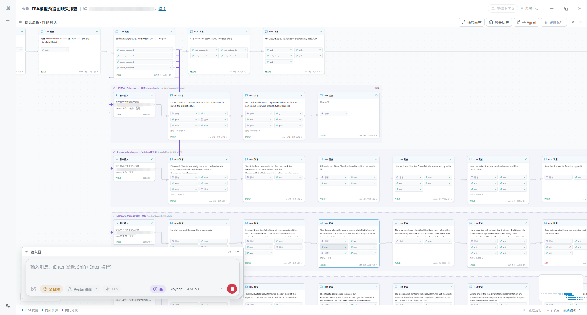
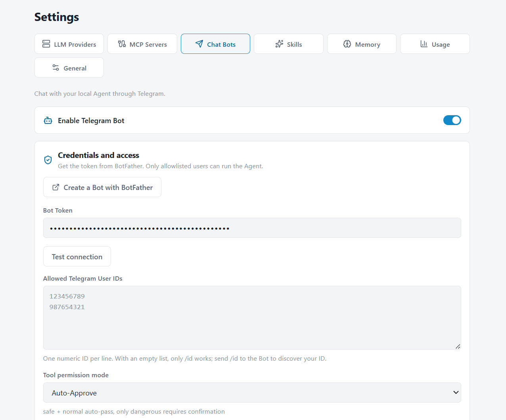

# Zhumora Agent

An open source desktop workspace for multiple AI agents, with a graph that shows how they complete your tasks. Available for Windows and Ubuntu Linux.

Zhumora connects to OpenAI-compatible models and can work with your files, terminal, browser, and desktop. It is designed as a local-first agent runtime with support for MCP, skills, memory, and user-controlled permissions.

The main agent plans the work, coordinates dependencies, reviews changes, and owns final validation. Subagents handle small, clearly scoped tasks, normally one file per coding assignment. Main and child agents can use separately configured models.

[简体中文](README.md) · [Vision (Chinese)](./docs/VISION.md) · [Presentation and promotion plan (Chinese)](./docs/PROMOTION.md) · [Technical documentation](./TECHNICAL.md) · [Bilibili video](https://www.bilibili.com/video/BV1Yyew6SEmN/)

<p align="center">
  
</p>

## The new workspace

Each LLM utterance is a main graph node. Reasoning returned by the model and tool calls appear as smaller steps inside it. Subagent branches start at the delegation step and return to the matching wait step after the parent retrieves a terminal result. Clicking a node shows its content, reasoning, tool arguments, and results.

Earlier user turns collapse by default while the latest stays open. Expanding and collapsing change the view, preserving the full message history.

The conversation graph, inspector, and composer can dock, float, or open in separate windows. Moving the composer preserves its unsent text and attachments. Light and dark themes apply throughout the workspace.

The canvas mouse wheel controls zoom. Auto-follow moves only when current work leaves the view and frames the main flow plus concurrent agents’ active frontiers. Your chosen zoom stays fixed; an offscreen-node notice offers an explicit Show active nodes action to adjust it. Open details track the main conversation and its current internal step: tool arguments, then results, then subsequent LLM content/reasoning. Queued calls do not take focus; manual step/tab selection pauses automatic switching. Details do not switch among siblings. Streaming content scrolls to the latest output. Scrolling upward pauses content following until you return to the bottom. Selecting historical nodes pauses run following.

## Features

- Explore conversations as utterance nodes with nested reasoning and tool steps, subagent branches, and returned results
- Dock, float, or detach the graph, inspector, and composer, with follow mode at your chosen zoom level
- Configure main and child models independently and control request concurrency per provider
- Connect to OpenAI-compatible APIs, including local endpoints such as Ollama, llama.cpp, and vLLM
- Read, edit, search, and manage files in the selected workspace
- Read and write Word, Excel, PowerPoint, and PDF artifacts with format-specific built-in tools
- Run terminal commands
- Automate Chromium with Playwright
- Observe and control Windows applications with accessibility targets, screenshots, mouse, and keyboard input (on Linux, desktop control keeps screenshot observation only)
- Extend tools through MCP servers
- Serve as an MCP server that external orchestrators (Claude Code, Codex, …) can delegate tasks to
- Load reusable skills from Markdown files
- Local session history, long-term memory, and token usage records
- Chat with the same agent from your phone through a Telegram bot or a QQ bot, with live progress updates
- Import VRM characters and opt into a separate transparent Avatar window per session, with Agent-controlled configured motions and expressions
- Import local sherpa-onnx VITS/Kokoro voices and opt into spoken final responses per session
- Permission prompts for potentially dangerous actions
- Light / dark themes and multilingual UI

## Chat from Telegram and QQ

Open **Settings → Chat Bots** and connect a Telegram bot or a QQ bot, then talk to the same local agent from your phone — no need to sit at the desktop.

<p align="center">
  
</p>

- **Two platforms** — Telegram via BotFather token, QQ via the AppID / AppSecret from QQ Open Platform. Both run the same agent, tools, permissions, and session history
- **See it working** — thinking streams live (`💭 …`) and every tool call shows up as it happens (`🔧 bash: npm test`), turning into `✅ 1.2s` when it finishes, so a long task never looks frozen
- **Approve from anywhere** — risky actions ask for confirmation in the chat: inline Allow / Deny buttons on Telegram, a `y` / `n` reply on QQ
- **Stay in control** — the bots only answer users you whitelist (send `/id` to get your ID / OpenID), and `/stop` cancels the current run at any moment

## Desktop control

Zhumora can operate the Windows desktop directly:

- **Observe** — list running applications, capture screens, and read the UI accessibility tree of any window (with short-lived semantic element targets)
- **Act** — click, double-click, right-click, type, press keys, scroll, drag, focus, and toggle controls, targeting elements by accessibility reference or screenshot coordinates
- **Verify** — attach a screenshot after state-changing actions so the agent can confirm the result; plain pointer moves skip capture unless requested

This lets Zhumora drive native Windows apps that have no API or CLI — not just files, shell, and the browser.

> On Linux the accessibility tree and input injection rely on the Windows-only Terminator library, so desktop control is limited to **screenshot observation** (`desktop_observe` in `screen` mode); all other capabilities (files, shell, browser, …) are unaffected.

## As an MCP server for external orchestrators

Zhumora is also an MCP server. External orchestrators such as Claude Code and Codex can treat it as a collaborator, hand it a bounded task, and let the same local agent do the work.

Turn it on under **Settings → MCP Inbound**. The page shows the live status and endpoint, and generates client configs you can paste directly (JSON for Claude Desktop, Cursor, Cline, …; TOML for Codex).

- **Loopback plus a token** — the server only listens on `127.0.0.1`, and clients authenticate with `Authorization: Bearer <token>`. The token is generated on first enable and persisted as-is, never rotated on app restart; re-copy the config after changing the token or port.
- **A delegation is a session** — every delegated task becomes a Zhumora session in the sidebar, reporting progress and writing history exactly like a session you started at the desktop, and it can be aborted at any time.
- **Follow through to the end** — the orchestrator posts work with `zhumora_chat` and waits with `zhumora_wait` (bounded long wait plus progress notifications), so it receives a self-contained final answer instead of mistaking `running` for done; results survive a dropped connection.
- **Permissions stay yours** — with the default “UI only” mode the orchestrator only sees that a task is awaiting permission, and you approve or deny in Zhumora. With “delegate” enabled it may approve normal-level tools through `zhumora_respond` within the authority you give it; dangerous actions always wait for you.
- **Diagnostics, not polling** — `zhumora_status` returns a transient snapshot of a task and is not a polling channel.

## Quick start

### Requirements

- Windows 10 / 11, or Ubuntu Linux (x64)
- Node.js 22.12+ (Node.js 24 LTS recommended)
- npm

### Install

```bash
npm install
```

### Development

```bash
npm run dev
```

### Build

```bash
npm run build
```

### Package for Windows

```bash
npm run build:win
```

### Package for Linux (AppImage / deb)

```bash
npm run build:linux
```

The installer is written to `release/`.

## Model configuration

Open **Settings** and add an OpenAI-compatible provider:

- Base URL
- API key, if required
- Model name
- Temperature
- Reasoning effort
- Context window
- Concurrency limit (a positive integer, or blank for unlimited)

Local and remote endpoints are both supported.

Set the limit under **Settings → LLM Providers** and save. All models, main agents, subagents, other sessions, and auxiliary completions using that provider share its allowance. Excess requests queue and remain cancellable. A streaming response holds its slot until it ends. Each provider has a separate allowance. This is a configured client limit, not an automatically discovered service capacity.

## Subagent collaboration

Enable subagents under **Settings → General → Agent behavior**, select a separate default provider/model or inherit the main model, and save. An explicit task-level model choice overrides the default. Continuing a child session keeps its original model. Disabling subagents blocks new or continued tasks, while existing tasks can still finish, be awaited, or be cancelled.

The main agent acts as an architect and coordinator. It defines interfaces, assigns independent file edits, checks actual diffs, and runs final integration validation. Each child normally edits one assigned file or answers one bounded read-only question. A parent run rejects duplicate assignments for a file that an active child still owns.

When enabled, the main agent is instructed to proactively dispatch ready independent tasks without the user mentioning subagents. It first agrees interfaces and acceptance criteria; trivial edits may stay with the parent.

Each provider has an **Allow subagents to use this provider** switch under **Settings → LLM Providers**, enabled by default. Turn it off to reserve an expensive provider for main sessions, and choose another child model in General settings. New and continued child tasks cannot use a disallowed provider, even through explicit model overrides. Running children may finish, be awaited or cancelled. An unavailable saved or inherited child model produces a clear error; no automatic provider switch occurs.

The composer’s **Parallel work** toggle requests scoped delegation for the next input (including execution of an existing plan), then resets. It changes no model, permission or provider limits.

Work orders support explorer, implementer, reviewer and verifier roles, necessary context, acceptance criteria, focused validation and an expected result format. `dependsOn` rejects dispatch until current prerequisite tasks complete and settle; the parent waits, reviews and dispatches dependent work explicitly. `list_subagents` exposes a paged task inventory. `send_subagent_message` queues a small clarification for a running child’s next safe turn boundary. Completion notices announce status; the parent still retrieves full deliverables with `wait_subagents` and verifies them. Profiles are work contracts, not tool or filesystem sandboxes.

Concurrency comes only from the selected provider's `maxConcurrency`. Blank means unlimited. There is no additional fixed simultaneous-child cap or cumulative child-start budget. Queued children remain active tasks.

The sidebar lists main conversations only. Inspect child work in the graph and use Open session in node details to view its complete history. Delegation supports one level, without nested child delegation. A parent ending or stopping cancels unfinished children, preserving their histories. Tasks do not resume automatically after an application restart. File assignments are coordination contracts, not filesystem sandboxes. Files, browser tabs, and the physical desktop remain shared, and all tools retain the normal permission controls.

## Our vision

We want people to organize an AI team on their own computers, understand its work, and intervene when needed. The user sets the goal, the main agent plans and verifies, and subagents complete focused tasks with inspectable execution records.

We will continue developing visual collaboration, model choice, and user control. More autonomous execution must keep authorization with the user. The [full vision](./docs/VISION.md) separates today's capabilities from future goals.

## VRM Avatar

Import `.vrm` characters under **Settings → Avatar**, then configure embedded animation names or attach `.vrma` animations (several files can be selected at once). Avatars are off by default for every session; select one from the upward-opening Avatar menu in the composer when needed. The character runs in its own draggable transparent window, and the Agent can only invoke motions and expressions reported or configured for that model.

Avatars include application-owned idle, nodding, head-shaking, greeting, waving, shrugging, bowing, applause, celebration and sadness motions, adapted to VRM 0/1. Default motions use expressive upper-body movement with naturally hanging arms; a procedural life layer adds breathing, subtle weight shifts, arm sway and finger flexion to every clip. Greeting, waving and celebration add a smile, while sadness lowers the head and uses the model's sad expression when available. They blink and vary their idle pose without LLM calls. Agent activity drives response gestures; one-shot gestures return to the current activity with blended transitions. Mouse gaze follows only inside the Avatar window and smoothly returns forward on exit. Expressions fade in and return to neutral automatically. Explicitly configured custom animations retain their own choreography.

Drag the character, message bubble or top handle to move its window; empty transparent space remains click-through. **Settings → Avatar → Window size** controls width and height in logical pixels for all Avatar windows, including already open ones after saving. Windows are fitted to the monitor's available work area.

## Local TTS

Import a compatible sherpa-onnx VITS or Kokoro model folder under **Settings → Speech**, then select the default voice and its speaker ID/speed. The TTS button in the composer is off for every new session. When enabled, only the final assistant response is converted from Markdown to bounded prose, synthesized locally, and played; Agent prompts, tools, and history are unchanged. Starting another request or synthesis interrupts the previous speech. Imported weights keep their own license and must contain `tokens.txt` plus one ONNX model file (`model.onnx` is preferred); Kokoro also requires `voices.bin`.

In the animation library, use the semantic dropdown to replace a built-in motion with an imported clip; the star selects the startup idle. The Agent can use one `avatar_control` call with `action: "perform"`, an `intent` and optional `emotion`/`intensity`. Exact clip playback remains available for explicit looping. Imported motion quality and unusual character proportions can still require model-specific animation adjustments.

No character model is bundled. The `@pixiv/three-vrm` code is MIT-licensed, but each VRM model has its own license; verify the model author's terms before importing or redistributing it.

## Documentation

The authoritative session/message architecture and contribution rules are documented in [ARCHITECTURE.md](./ARCHITECTURE.md) and [AGENTS.md](./AGENTS.md). Tool interfaces, context management, memory, MCP, and build notes are in [TECHNICAL.md](./TECHNICAL.md).

The [vision](./docs/VISION.md) and [promotion plan with a presentation](./docs/PROMOTION.md) describe the product direction. Report bugs with reproduction steps through [GitHub Issues](https://github.com/lr8soft/zhumora/issues).

## License

Zhumora is licensed under the [AGPL-v3.0](./LICENSE.md).

Versions previously made available under the MIT License remain available under
the terms granted for those versions. Third-party components retain their own
licenses; see [THIRD_PARTY_NOTICES.md](./THIRD_PARTY_NOTICES.md).
